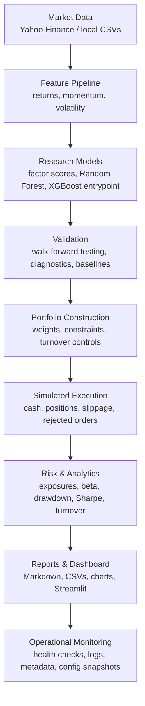

# Quantitative Trading Research and Paper-Trading Platform

This repository is a modular quantitative equity research and paper-trading platform built around
cross-sectional factor research, machine learning validation, portfolio construction, risk controls,
execution simulation, and reporting.

The project is designed to demonstrate a reproducible research workflow and a local simulated
paper-trading process. It is not a live-money trading system, and it does not enable real-money order
execution.

## At a Glance

- What it is: a Python research and simulated paper-trading platform for cross-sectional equity
  strategies.
- Why it matters: it shows how a signal moves through data preparation, validation, portfolio
  construction, risk checks, simulated execution, reporting, and monitoring.
- Skills demonstrated: factor research, return-label hygiene, machine learning ranking,
  walk-forward validation, transaction-cost-aware backtesting, portfolio constraints, execution
  simulation, dashboards, documentation, and tests.
- Fastest local check: run `python scripts/run_smoke_tests.py` or `make smoke`.
- Full workflow entry points: see `How to Run the Full Workflow` and `Command Shortcuts` below.
- Safety boundary: all trading workflows are local or simulated by default; results are research
  outputs, not investment promises.

## Project Highlights

- End-to-end quant workflow covering data ingestion, factor engineering, ML ranking, walk-forward
  validation, portfolio construction, execution simulation, and reporting.
- Cross-sectional equity strategy using momentum, short-term return, volatility, and
  machine-learning features across an S&P 100-style universe.
- Transaction-cost-aware backtesting with benchmark comparison, drawdown analytics, turnover
  tracking, and volatility-aware risk controls.
- Long-only simulated paper-trading system with cash accounting, positions, fills, rejected orders,
  stale-signal checks, and execution logs.
- Portfolio constraint layer covering max weights, exposure diagnostics, concentration, turnover,
  liquidity checks, and no-shorting behavior.
- Streamlit dashboard, Markdown reports, CSV outputs, operational logs, configuration snapshots, and
  automated tests for reviewability.
- Built as a local research and simulated paper-trading platform; no live-money execution is enabled.

## Recruiter Summary

This project presents a quantitative research and engineering workflow in Python, with emphasis
on defensible validation, transparent assumptions, reproducible outputs, and operational controls.
It demonstrates practical skills relevant to quant research, systematic trading, and financial
engineering interviews: feature design, return-label hygiene, walk-forward testing, transaction-cost
modeling, risk management, execution simulation, monitoring, reporting, and test coverage.

The repository is intentionally structured like a lightweight research platform rather
than a single notebook. Code is modular, outputs are documented, and limitations are stated directly
so reviewers can evaluate both the technical implementation and the research discipline behind it.

## Quick Links

- Research report: `reports/quant_research_report.md`
- Paper-trading status: `reports/paper_trading_status.md`
- System health report: `reports/system_status.md`
- Multi-day simulation report: `reports/multi_day_simulation_report.md`
- Dashboard: `dashboard/app.py`
- Daily paper-trading runner: `scripts/run_daily_paper_trading.py`
- Paper-trading checklist: `docs/paper_trading_checklist.md`
- Paper-trading journal template: `docs/paper_trading_journal_template.md`
- Paper-trading risk review: `docs/paper_trading_risk_review.md`
- Operational workflow: `docs/operational_workflow.md`
- Quant interview guide: `docs/quant_interview_guide.md`
- Central configuration: `config/platform_config.json`

Generated CSVs, charts, model files, execution logs, and operational JSONL logs are written under
`results/` or generated report folders. Selected report snapshots and charts are committed for
review; regenerated artifacts and local operator outputs are ignored where practical so the
repository stays focused on reproducible code, configuration, documentation, and lightweight evidence.

## System Architecture

The platform is organized as a research-to-operations pipeline: market data flows into feature
generation, model validation, portfolio construction, simulated execution, risk analytics, reporting,
and operational monitoring.

### Architecture Overview



### Visual Output Map

| Research Layer | Review Artifact (committed unless noted) |
|---|---|
| Strategy backtesting | `results/strategy_vs_benchmark.png`, `results/multi_factor_results.csv` |
| Walk-forward ML chart | `results/walk_forward_ml_strategy.png` (metrics CSV not committed) |
| Risk analytics | Generated locally by `make report` under `results/reports/` (gitignored) |
| Paper trading status | `reports/paper_trading_status.md` |
| Monitoring | `reports/system_status.md` |

## Repository Structure

```text
algorithmic-trading-project/
├── config/                       # Central platform configuration
├── dashboard/                    # Streamlit reporting dashboard
├── docs/                         # Operator checklists and workflow notes
├── reports/                      # Lightweight Markdown report snapshots
├── research/                     # Trial log (DSR N) and one-off diagnostics; see research/README.md
├── scripts/                      # Daily paper-trading workflow runner
├── src/
│   ├── backtests/                # Strategy and benchmark backtest engines
│   ├── data/                     # Reusable data loading helpers
│   ├── execution/                # Simulated broker and paper execution tools
│   ├── features/                 # Factor and ML feature generation
│   ├── live/                     # Local signal generation for paper trading
│   ├── models/                   # ML training and validation utilities
│   ├── operations/               # Config loading, structured logging, health checks
│   ├── portfolio/                # Allocation, constraints, and portfolio utilities
│   ├── reporting/                # Metrics, analytics, charts, and summary reports
│   ├── risk/                     # Exposure and volatility utilities
│   └── simulation/               # Multi-day paper-trading simulation
├── tests/                        # Automated correctness and safety tests
├── requirements.txt              # Direct dependencies (hand-edited spec)
├── requirements.lock             # Full pinned + hashed lock (CI and `make install`)
└── README.md
```

## How to Run the Full Workflow

Install dependencies (exact locked versions, same as CI):

```bash
pip install --require-hashes -r requirements.lock   # or: make install
```

`requirements.txt` is the hand-edited list of direct dependencies; `requirements.lock` pins every
package, including transitive ones, with sha256 hashes for Python 3.12+ on Linux/macOS/Windows.
To change a dependency: edit `requirements.txt`, run `make lock` (= `uv pip compile requirements.txt
--python-version 3.12 --universal --generate-hashes -o requirements.lock`; `pip install uv` first),
run the tests, and commit both files. `tests/test_dependency_lock.py` fails if a direct dependency's
version in the lock differs from `requirements.txt` or a locked package has no hash, and CI
regenerates the lock with the pinned `uv==0.13.7` and fails if the file changes.

Run the data pipeline:

```bash
python src/data_loader.py            # research snapshot: prices + data/volume_data.csv (to END_DATE)
# python src/data_loader.py --volume-only  # refresh volume without touching prices
python src/factors.py
python src/ml_dataset.py
```

Regenerate every committed research artifact from the checked-in data, in dependency order
(no download, no trading; about 2 minutes), and verify the numbers quoted in the docs:

```bash
make research                                    # = python scripts/run_research_pipeline.py
python scripts/run_research_pipeline.py --list   # show the 14 steps and their outputs
python scripts/run_research_pipeline.py --from significance
```

The steps are: data checks → factors → ML dataset → momentum IC → momentum backtest → ML
baseline → ML backtest → multi-factor → risk-managed → walk-forward (nested) → multi-day sim →
significance + benchmark-relative (using the walk-forward returns just written) → beta diagnosis
→ doc-metric check. On an unchanged checkout the tracked CSVs come back identical (ML
predictions can differ in the last floating-point digit); review `git diff --stat` after a run.

**Quoted numbers are checked.** Current-result numbers in `README.md` and
`reports/quant_research_report.md` are wrapped in invisible HTML-comment markers (an opening
`m:KEY` comment before the value and a closing `/m` comment after it; format in
`src/reporting/doc_metrics.py`). `python src/check_doc_metrics.py` recomputes every key from
the committed result files (`--list` prints them) and fails on any mismatch, on unknown keys, or
when a required headline metric is no longer marked in the README; `--fix` rewrites mismatched
values. `tests/test_doc_metrics.py` runs the same check in CI. Historical "before" numbers are
deliberately left unmarked. When editing results text, wrap new current-result numbers the
same way.

Or run research backtests and model validation step by step:

```bash
python src/train_ml_model.py
python src/train_xgboost_model.py
python src/multi_factor_backtest.py
python src/walk_forward_ml_backtest.py
python src/risk_managed_backtest.py
python src/generate_report.py
```

Run live signal generation for the simulated paper-trading workflow:

```bash
python src/live/generate_live_signals.py
```

Run simulated paper trading:

```bash
python scripts/run_daily_paper_trading.py
python src/simulation/run_multi_day_simulation.py
```

Run the dashboard:

```bash
streamlit run dashboard/app.py
```

Run tests:

```bash
pytest -q
```

Run the end-to-end smoke test runner:

```bash
python scripts/run_smoke_tests.py
```

Run a syntax smoke test across the source tree:

```bash
python -m compileall src scripts dashboard tests
```

## Command Shortcuts

The repository includes a `Makefile` with simple reproducibility shortcuts. These commands wrap
existing scripts only and are safe by default: they support local research, reporting, simulated
paper trading, and dashboard review. They do not enable live-money trading.

| Command | Purpose |
|---|---|
| `make install` | Install the exact locked environment: `pip install --require-hashes -r requirements.lock` (what CI uses). |
| `make install-loose` | Install only the direct dependencies from `requirements.txt` (pip resolves the rest). |
| `make lock` | Regenerate `requirements.lock` after editing `requirements.txt` (needs `pip install uv`). |
| `make test` | Run the automated test suite with `pytest -q`. |
| `make smoke` | Run the lightweight end-to-end smoke test runner. |
| `make signals` | Generate the latest local paper-trading signal file. |
| `make paper` | Run the local simulated paper-trading workflow with data refresh skipped (uses `data/paper/`). |
| `make paper-data` | Refresh the paper data dir `data/paper/` (prices, volume, SPY through today); never touches `data/`. |
| `make paper-data-check` | Data checks on `data/paper/` against its own manifest. |
| `make paper-status` | Print and write the paper account summary `results/paper/status.md` (active and recent alerts, last gate, latest run, journal tail). |
| `make paper-daily` | Scheduled paper day: lock → refresh → data gate → paper day → status → weekly review → rotating backup (keeps the newest `paper_trading.backup_keep` = 10). Exit 0 ok/skipped, 1 failed, 2 blocked, 3 locked. |
| `make paper-review` | Write this week's review to `results/paper/reviews/weekly-<YYYY>-W<ww>.md/.json` (`--week-of DATE` for another week). |
| `make paper-backup` | Write a verified backup of the paper account to `backups/paper/` (restore: `python scripts/paper_backup.py restore FILE`). |
| `make dashboard` | Start the Streamlit dashboard. |
| `make report` | Regenerate research and risk summary reports. |
| `make health` | Run the operational health check (includes the data checks below). |
| `make research` | Regenerate every committed research artifact in dependency order, then verify the numbers quoted in the docs. |
| `make doc-metrics` | Only verify quoted numbers in `README.md` / `reports/quant_research_report.md` against the result files. |
| `make data-check` | Data freshness, alignment, quality and manifest checks; writes `reports/data_quality_report.md`. |

## Paper Trading Workflow

The paper-trading workflow is local and simulated by default. It refreshes data, runs a pre-run
data gate, rebuilds features, generates signals, applies safety checks, routes orders through the
simulated broker, snapshots and reconciles the result, appends the journal, updates risk reports,
and refreshes dashboard inputs. Nothing is sent to any real broker.

Paper and research data are separate directories:

| Directory | Used by | Written by |
|---|---|---|
| `data/` (checked in) | `make research`, multi-day simulation, reports, doc-metric checks | only an explicit `python src/data_loader.py` without `--paper` (research re-download) |
| `data/paper/` (gitignored) | the daily paper workflow: gate, features, ML dataset, signals, simulated fills | `python src/data_loader.py --paper` / the daily runner's refresh |

The paper dir is `paper_trading.data_dir` in `config/platform_config.json`, overridable with
`$PAPER_DATA_DIR` or `--data-dir`; it is refused if it resolves to `data/`. Each paper refresh
writes `data/paper/data_manifest.json` (SHA-256 of the three dated inputs), so the gate's manifest
check catches a paper file edited after the refresh, and every run's `run.json` records the files
and dates the gate saw. The risk-report step still summarises the research backtest from `data/`
(read-only).

Run the daily workflow (full refresh of price, volume and SPY through today into `data/paper/`
with `src/data_loader.py`, then the paper day):

```bash
python scripts/run_daily_paper_trading.py
```

Run the same workflow without downloading fresh data (`make paper`):

```bash
python scripts/run_daily_paper_trading.py --skip-data-refresh
```

### Paper-run operations

| Safeguard | Behaviour |
|---|---|
| Pre-run data gate | Runs the data checks with staleness raised to **ERROR** (`data_checks.paper_stale_severity`); any data ERROR blocks the run before features/signals/orders, prints the reasons and exits with code 2. `make data-check`, `make health` and research keep staleness at WARNING. `--as-of YYYY-MM-DD` sets the freshness reference date (default today). |
| Idempotency | The key is the signal date (latest local price date). A rerun for a completed date logs `already completed …; skipping` and trades nothing. `--force` replaces only the most recent run: its pre-run state is restored first, so the day is re-simulated once, not stacked. Dates older than the latest completed run are refused. Any failure restores `results/simulation/*` and leaves no run folder. |
| Dated snapshot | `results/paper/runs/<signal date>/`: `run.json` (metadata, NAV, data-gate and reconciliation results), `start_state.json` / `end_state.json` (cash + positions), `positions_start.csv` / `positions_end.csv`, `orders.csv`, `fills.csv`, `rejected.csv`, and `pre_run_state/` (copy of the simulation files used by `--force`). Written to a staging folder and moved into place atomically. |
| Reconciliation | Before trading: starting cash/positions must equal the previous run's `end_state.json`, and the previous `start_state.json` + `fills.csv` must reproduce that end state (cash ± $0.01, quantity ± 1e-6). A mismatch blocks the run (override: `--allow-reconciliation-mismatch`) and is an **ERROR** in `make health` (`paper_reconciliation`) until a clean run. After trading the same replay checks the new run. |
| Alerts | Local only: appended to `results/paper/alerts.jsonl`, mirrored to `results/operations/platform_events.jsonl` (`paper_alert`) and printed as `ALERT [...]` lines; nothing is emailed or messaged. Kinds: `data_gate_blocked` (ERROR), `reconciliation_mismatch` (ERROR, pre- or post-run), `drawdown_halt` (WARNING, rebalance skipped), `run_blocked` (WARNING, e.g. out-of-order date). |
| Status summary | `results/paper/status.md` / `status.json`, rewritten after every gate decision, run and alert, and by `make paper-status` (`python scripts/paper_status.py --strict` exits 1 on an active ERROR). Active alerts reflect the current state (last gate, last reconciliation, latest run's halt flag) and clear after a clean run; the alert history stays in `alerts.jsonl`. |
| Lock | Every paper run (`scripts/run_daily_paper_trading.py`, `make paper`, `make paper-daily`) takes `results/operations/paper_daily.lock` (atomic create; pid, host, start time). A second run exits with code 3, a `run_blocked` alert and no trading. A stale lock (pid gone on this host, older than `paper_trading.lock_stale_hours` = 6, or unreadable for > 30 s) is removed with a log line. |
| Weekly review | `results/paper/reviews/weekly-<ISO week>.md/.json` from `journal.csv`, `alerts.jsonl` and `gate_history.csv` (one row per gate decision): runs, NAV start → end, PnL incl. costs, return, trades/rejections, turnover total and per run, worst drawdown, halts, reconciliation mismatches, ADV clips, forced reruns, alerts by kind, and gate checks / blocks / block rate. Runs count by signal date; alerts and gate checks by UTC timestamp. Written by `make paper-daily` and `make paper-review`. |
| Backup / restore | `python scripts/paper_backup.py backup [--out FILE] [--force]`, `verify FILE`, `restore FILE [--force]`, `list`. The `.tar.gz` holds `results/paper/`, `data/paper/` and the top-level `results/simulation/` broker state (needed so the next run reconciles), plus `BACKUP_MANIFEST.json` with SHA-256 and size per file. Verify rejects modified, missing, unlisted, absolute or `..` members. Restore verifies first, refuses to overwrite existing state without `--force`, writes a `pre-restore-*.tar.gz` safety backup when forced, extracts to a staging folder, re-checks every hash, then swaps the folders in. `backups/` is gitignored. |
| Rebalance order | Each paper rebalance executes all sells first, then sizes buys from the cash on hand after those sells (pro-rata scale-down with a `BUYS_SCALED_TO_CASH` warning only if the existing allocation and fill buffers are not enough). Cash never goes negative and buys are not rejected just because exits had not filled. The multi-day simulation now runs the same shared helper (`execute_rebalance_orders` in `src/execution/simulated_broker.py`; trial log row 45, increment 0). It already sorted sells first and never needed a buy scale-down, so its outputs are byte-identical and its checked-in numbers are unchanged. |
| Tracking vs backtest | After every run, `results/paper/tracking.csv` compares the paper account with a frictionless backtest of the same signals (each run now stores `targets.csv` and `prices.csv`): **holding gap** = paper return between runs (`nav_start_i / nav_end_{i-1} - 1`) minus the previous run's target weights at the two runs' prices; **cost ratio** = realized rebalance cost per traded dollar / modeled commission + slippage + half-spread (17 bps; impact not modeled); **weight deviation** = Σ\|realized − target\| after the rebalance. Fixed thresholds (`paper_tracking`, set 2026-11-09 from the simulator design before any result was computed; not tuned): gap > 50 bps WARNING, > 200 bps ERROR; weekly cumulative gap > 100 bps WARNING; weight deviation > 10% of NAV WARNING; cost ratio outside 0.75–2.0 WARNING (only when traded ≥ 0.5% of NAV). Intervals after a drawdown halt, without targets, or with > 5% of target weight unpriced are skipped. Breaches raise a `tracking_breach` alert and show in `status.md`; the weekly review adds cumulative gap, tracking error (std of gaps), largest gap, mean cost ratio and largest weight deviation. Engineering check only; not a strategy trial and no research output changes. |
| Journal | `results/paper/journal.csv` and `results/paper/journal.md`: one row per signal date with NAV, PnL vs previous run, return, trades, rejected orders, turnover, drawdown, drawdown-halt flag, vol scale, ADV clips (target weights clipped / orders clipped), data-check status and reconciliation status. `results/paper/ledger.csv` is the run ledger. Reruns replace rows instead of duplicating them; duplicate ledger rows are a health ERROR. |

Snapshots, ledger and journal are **not committed**: `results/` is gitignored because this is
operator-local state that changes every trading day (committing it would churn history and mix
one machine's paper account into the research repo). Back up `results/paper/` if you want to keep
the paper account across machines. `reports/paper_trading_journal.md` stays as the place for
manual review notes.

End-to-end paper day after refreshing data with the loader:

```bash
python src/data_loader.py --paper                         # data/paper/: prices + volume + SPY through today
python src/check_data.py --paper                          # paper checks (staleness WARNING here, ERROR in the gate)
python scripts/run_daily_paper_trading.py --skip-data-refresh
cat results/paper/journal.md
make paper-status                                         # summary + alerts -> results/paper/status.md
python scripts/run_daily_paper_trading.py --skip-data-refresh   # rerun: "already completed ... skipping"
python scripts/run_daily_paper_trading.py --skip-data-refresh --force   # replace that day once
make health
make paper-backup                                         # backups/paper/paper-backup-<UTC>.tar.gz
python scripts/paper_backup.py verify backups/paper/paper-backup-<UTC>.tar.gz
```

Scheduling examples (cron and a systemd timer; not installed by this repo) are in
`docs/operational_workflow.md`. The dashboard's "Paper Account" tab shows `status.json`, the
journal NAV and recent alerts (read-only).

Paper refreshes run yfinance without its progress bar and do not request excluded symbols
(BK), so paper logs show one summary line per file instead of the download bar.

`git status` stays clean: the refresh, features and ML dataset all go to `data/paper/`, so
`make research` keeps reading the checked-in snapshot without any restore step. Offline demo:
`python src/data_loader.py --paper --seed-from-research` copies the checked-in inputs into
`data/paper/`; their last date is 2026-10-30, so add `--as-of 2026-10-30` to the paper run (the
gate blocks otherwise).

Run a multi-day operating-loop simulation:

```bash
python src/simulation/run_multi_day_simulation.py
```

Useful simulation options:

```bash
python src/simulation/run_multi_day_simulation.py --rebalance-frequency daily
python src/simulation/run_multi_day_simulation.py --start 2025-08-01 --end 2025-12-31
```

The simulated broker tracks:

- Cash and portfolio value.
- Long-only positions.
- Trade history and rejected orders.
- Slippage-adjusted fill prices.
- Transaction costs.
- Portfolio snapshots and execution logs.
- Stale signal and missing price diagnostics.

The workflow never submits live-money orders. The separate Alpaca paper executor is dry-run by
default and targets paper endpoints only.

## Strategy And Validation

The research stack combines transparent factor models with machine-learning ranking:

- 12-month momentum: `Price(t) / Price(t - 252) - 1`.
- Short-term momentum: `Price(t) / Price(t - 21) - 1`.
- 21-day rolling volatility.
- Random Forest return-ranking model using 1-month forward returns as labels.
- XGBoost training entrypoint for comparison experiments.
- Expanding-window walk-forward validation with **nested / anchored model selection**.

The reported outer walk-forward schedule is:

| Train Period | Test Period |
|---|---|
| 2018-2021 | 2022 |
| 2018-2022 | 2023 |
| 2018-2023 | 2024 |
| 2018-2024 | 2025 |
| 2018-2025 | 2026 (through 2026-09-30) |

**Nested selection (default on):** for each outer year fold, a small candidate menu
(`ridge_1`, `rf_shallow`, `rf_default`) is scored on **inner** expanding year folds that use
only the purged outer training sample (month-end subset for speed). The winner is refit on the
full outer train set and then applied to the outer test year. Purge/embargo (21-day labels)
apply to both outer and inner folds.

Default **inner score** is `cost_aware_sharpe` (`research.nested_inner_score`): annualized Sharpe
of equal-weight long/short month-end returns after `turnover × transaction_cost` and stock-borrow /
financing on the signed weight book. Alternatives: `icir` = mean(IC)/std(IC), and legacy
`rank_ic`. Inner books use the **same construction as the outer research book**: sector-demeaned
ranking, sector net caps, gross P&L as `sum(w·r)` on those capped weights, and (with
`research.nested_inner_vol_targeting: true`, default) the same causal EWMA vol-target scale,
estimated only from each candidate's *earlier* inner-validation net returns — never the outer
test fold. This reduces hyperparameter peeking into the test year; it does **not** remove bias
from the candidate menu itself or from repeated research iteration. Selection log:
`results/reports/nested_model_selection.csv`. Disable with `research.nested_walk_forward: false`.

**Selection rule (decided a priori, before regenerating results).** Inner cost-aware Sharpe
scores for the three candidates are typically negative and within a few tenths of each other,
estimated from only 12–60 inner months. Taking the argmax of such noisy scores lets sampling
noise pick the model each year. The default rule is therefore the cross-validation **one-SE
rule** (`research.nested_selection_rule: one_se_fallback`): a pre-declared default model
(`research.nested_default_model: rf_default`, the production model used by the non-nested path)
is kept unless the best inner candidate beats it by more than
`research.nested_selection_se_threshold` (1.0) standard errors of the **paired per-month
difference** in inner net returns (per-date IC differences for `rank_ic`/`icir`). We chose a
fallback over an ensemble as the primary rule because it keeps a single, auditable production
model and changes nothing unless there is evidence; the threshold (1 SE) is the textbook value,
not tuned. Alternatives behind config: `best` (legacy argmax) and `ensemble_equal` (equal-weight
blend of all candidates, each z-scored with its own *training-set* prediction mean/std). The rule
was fixed before looking at the regenerated walk-forward numbers; switching rules because of the
outer-test result would be test-set selection.

**Inner borrow.** With `research.nested_inner_name_level_borrow: true` (default), inner shorts are
charged from the same point-in-time HTB tier panel as the outer book (ADV$ + volatility proxy
from data on/before each inner date, plus static overrides), instead of the flat GC rate.

**Beta-neutral long/short construction (design fixed a priori, before any backtest; trial log
rows 41–42).** The benchmark-relative tests showed the walk-forward L/S book carried β ≈ 0.5
despite being dollar-neutral. Research L/S books (walk-forward ML, multi-factor, and the nested
inner scorer) therefore balance *beta* rather than dollars by default
(`research.beta_neutral: true`):

- **Benchmark: SPY** (`data/benchmark_prices.csv`). It is investable (the natural hedge), a
  standard market proxy, and independent of our survivorship-biased ticker list; the
  equal-weight universe would contain each stock itself and inherit the universe bias.
- **Per-name beta:** OLS slope of daily returns on SPY over the trailing
  `beta_lookback_days = 252` trading days ending at the rebalance date's close (data available
  at that date only), requiring `beta_min_obs = 126`; names with too little history get β = 1.
  Betas are **Blume-shrunk** toward 1: `β = 2/3·β_raw + 1/3` (`beta_shrinkage = 1/3`), the
  classic adjustment for mean reversion and estimation noise in betas.
- **Leg scaling:** with long gross L, short gross S and leg betas B_L = Σ w_i β_i (longs),
  B_S = Σ |w_j| β_j (shorts), scale the long leg by `a` and the short leg by `b` so
  `a·B_L = b·B_S` while `a·L + b·S` keeps the book's gross. The long/short gross ratio is
  bounded to `[1/beta_neutral_max_leg_ratio, beta_neutral_max_leg_ratio]` with ratio 2.0; if
  the bound binds, the residual beta is accepted and reported.
- **Constraint interaction:** leg scaling and the sector net caps are applied alternately
  (up to 5 rounds) so both hold approximately; vol targeting then scales the whole book
  uniformly (beta stays ≈ 0); turnover and name-level borrow are charged on the final weights;
  eligibility/ADV filters are upstream and unchanged.
- Momentum-only and the long-only paper/sim paths are unchanged.

**EWMA beta estimator (design fixed a priori, before any backtest; trial log row 43 — one
trial).** The 252-day equal-weight OLS beta reacts slowly, and the multi-factor book kept a
realized SPY beta ≈ -0.2 with ex-ante beta ≈ 0 (diagnosis in
`reports/quant_research_report.md`, "Beta-Neutral Construction"). The beta estimator is now a
config choice, `research.beta_estimator: ols | ewma`, with **`ewma` the declared default**:

- **Weighted OLS slope** of daily stock returns on SPY with exponentially decaying weights
  `w_k ∝ 0.5^(k / h)` (k = trading days before the rebalance close, k = 0 is the rebalance day),
  **half-life `h = beta_ewma_half_life_days = 63`** (one quarter). Rationale: a quarter is the
  usual horizon over which factor-portfolio composition and sector/style betas drift, it is a
  quarter of the 252-day window (so the estimate still averages ≈ 180 effective days —
  `(1+λ)/(1-λ)` with `λ = 0.5^(1/63)` — and is not dominated by noise), and it is the
  RiskMetrics-style choice used for medium-horizon equity risk models. It was not tuned; no
  other half-life is run.
- Same window (`beta_lookback_days = 252`, weights renormalised within it; the 252-day-old
  observation keeps 0.5^4 ≈ 6% of the newest weight), same `beta_min_obs = 126`, same Blume
  shrinkage toward 1 (`beta_shrinkage = 1/3`), same β = 1 fallback, still causal (only closes
  on/before the rebalance date).
- Applied consistently: multi-factor, walk-forward ML outer book, and the nested inner scorer
  all read the same panel. `beta_estimator: ols` reproduces fe8b173 exactly.
- Default stays `ewma` whatever the outcome: reverting because the outer test got worse would
  be test-set selection. The walk-forward re-run under the new estimator is reported as part of
  this single trial, not as a separate variant.

Forward returns are used only as labels or realized outcomes. They are not used to form live
signals.

## Quant Research Concepts Demonstrated

- Factor research: momentum, short-term return, volatility, and ML-derived ranking features.
- IC testing: rank information coefficient analysis for factor quality review.
- Walk-forward validation: expanding-window training, nested/anchored inner model selection, and out-of-sample test periods.
- Transaction-cost-aware backtesting: turnover and cost assumptions included in strategy evaluation.
- Volatility targeting: volatility-adjusted sizing utilities and risk-managed backtest outputs.
- Portfolio constraints: long-only weights, max position sizing, exposure diagnostics,
  concentration checks, and liquidity-aware controls where data is available.
- Execution simulation: simulated broker with cash, positions, fills, slippage, transaction costs,
  rejected orders, and paper-trading logs.
- Operational monitoring: structured logs, run metadata, config snapshots, health reports, and stale
  signal checks.

## Risk Controls
- Drawdown halt (paper/sim): when portfolio drawdown reaches `risk_limits.max_drawdown_warning` (default **-10%**), the paper/sim rebalance is **skipped** (book frozen) so the process does not add risk or rotate into cash during the breach. Health monitoring emits a WARNING at the same threshold.

The platform includes reusable controls and diagnostics intended to make portfolio behavior more
auditable:

- Max position sizing.
- Sector exposure tracking and limits.
- Gross and net exposure tracking.
- Concentration metrics and top-holdings reports.
- Turnover-aware transaction cost calculations.
- Volatility-adjusted sizing utilities.
- Liquidity and average daily dollar volume filters when volume data is available.
- Rolling volatility, rolling Sharpe, rolling drawdown, and rolling beta analytics.
- Long-only paper-trading mode by default.
- No-shorting and no-leverage checks in the simulated broker.
- Missing price, stale signal, duplicate ticker, and abnormal target-weight checks.
- Structured operational logs, run metadata, config snapshots, and health monitoring.

These controls are designed to make unrealistic assumptions visible. They are not presented as a
complete production risk system.

## Results Summary

Headline multi-factor metrics below are recomputed from the committed artifact
`results/multi_factor_results.csv` (`portfolio_return` column) using the project's
`calculate_performance_metrics` helper, with the PIT eligibility filter, **HTB borrow tiers**,
**sector-neutral construction**, **beta-neutral legs** (SPY, EWMA betas with 63-day half-life,
see design above), and **EWMA
volatility targeting** (`research.vol_estimator=ewma`, target 15% ann. vol, half-life 3 periods, scale clipped to
[0.5, 1.5]; `realized` remains available). Sample window:
**2019-01-31 → 2026-09-30** (<!--m:mf.n-->93<!--/m--> month-end observations). Ending wealth in
`results/multi_factor_equity_curve.csv` is **<!--m:mf.ending_wealth-->1.2529<!--/m-->**, matching **<!--m:mf.cumulative-->25.29%<!--/m-->** cumulative return.
Regenerating with `make report` writes the same family of numbers to local
`results/reports/summary_report.md` / `.csv` (gitignored).

| Metric | Value from `results/multi_factor_results.csv` |
|---|---:|
| Annual return | <!--m:mf.annual_return-->4.76%<!--/m--> |
| Annual volatility | <!--m:mf.annual_volatility-->19.27%<!--/m--> |
| Sharpe ratio | <!--m:mf.sharpe-->0.25<!--/m--> |
| Max drawdown | <!--m:mf.max_drawdown-->-41.35%<!--/m--> |
| Cumulative return | <!--m:mf.cumulative-->25.29%<!--/m--> |
| Average one-way turnover (rebalance log, after first) | <!--m:mf.turnover_avg-->123.91%<!--/m--> |
| Mean vol scale | <!--m:mf.vol_scale-->0.89<!--/m--> |

History: dollar-neutral (e433b15) 6.43% / 20.88% vol / Sharpe 0.31 / -42.40% / +38.82%;
beta-neutral with 252-day OLS betas (fe8b173) 4.98% / 19.33% / 0.26 / -41.04% / +27.29%.
Ex-ante SPY beta is ≈ 0 on <!--m:mf.ex_ante_neutral_count-->91<!--/m--> of <!--m:mf.n-->93<!--/m--> rebalances (the 2:1 leg ratio bound binds twice), but the
**realized** beta stays ≈ <!--m:rel.mf.spy.beta-->-0.19<!--/m--> (SPY) / <!--m:rel.mf.ew.beta-->-0.30<!--/m--> (EW) with either estimator. The diagnosis
(`research/diagnose_multi_factor_beta.py`, written up in the report) points to a **horizon
mismatch**, not beta drift: on daily data the held names' betas — even measured with look-ahead
over the following year — net to ≈ +0.07, but on monthly returns the short leg (recent winners,
weak 12-month momentum) moves 1.13× the market and the long leg 0.97×. The EWMA estimator
(trial 43) targets drift, so as the diagnosis predicted it barely changed the realized beta; the
default stays `ewma` because it was declared before the run.

These are research outputs from the current committed backtest series, not forward-looking
claims. Interpret them with the limitations below (residual survivorship bias, static sector map,
simplified transaction costs, idealized execution).

### Walk-forward ML (regenerated 2026-11-09, beta-neutral legs with EWMA betas + one-SE nested selection)

From `results/walk_forward_metrics.csv`, regenerated with month-end rebalancing, purge/embargo,
research L/S gross 2.0 (base, before vol scale), PIT eligibility, HTB tiers, sector neutrality,
**beta-neutral legs** (SPY, EWMA betas with 63-day half-life; the nested inner scorer uses the
same panel), **EWMA vol targeting**, and nested `cost_aware_sharpe` under the pre-declared **`one_se_fallback`** rule
(see "Selection rule" above). Distinct from paper `MAX_GROSS_EXPOSURE=1.0`.
Sample: **2022-01-31 → 2026-09-30** (<!--m:wf.n-->57<!--/m--> periods). Mean research vol scale ≈ **<!--m:wf.vol_scale-->1.14<!--/m-->**.

| Metric | β-neutral, EWMA betas (current) | β-neutral, OLS betas (fe8b173) | Dollar-neutral (147723c) |
|---|---:|---:|---:|
| Annual return | <!--m:wf.annual_return-->6.30%<!--/m--> | 5.97% | 11.62% |
| Annual volatility | <!--m:wf.annual_volatility-->14.05%<!--/m--> | 13.98% | 16.29% |
| Sharpe ratio | <!--m:wf.sharpe-->0.45<!--/m--> | 0.43 | 0.71 |
| Max drawdown | <!--m:wf.max_drawdown-->-14.59%<!--/m--> | -15.94% | -20.08% |
| Cumulative return | <!--m:wf.cumulative-->28.84%<!--/m--> | 26.84% | 62.96% |
| Realized beta vs SPY (HAC regression) | <!--m:rel.wf.spy.beta-->0.11<!--/m--> | 0.14 | 0.54 |

The EWMA estimator moved walk-forward numbers only slightly (Sharpe 0.43 → 0.45, realized SPY
beta 0.14 → 0.11); differences this small are noise at T = 57. Beta-neutral legs (fe8b173) cut
realized SPY beta from 0.54 to 0.14 (ex-ante beta ≈ 0 at every
rebalance) and lowered volatility and drawdown, but **halved the return and Sharpe**: much of the
dollar-neutral book's performance was market exposure in a rising market, as the
benchmark-relative tests had suggested. **Every outer year still chose `rf_default`** (fallback
in 2022, 2023, 2025; `rf_default` was the inner-best in 2024 and 2026). The
`paired_mean_diff` / `paired_se` columns in `results/reports/nested_model_selection.csv` show the
challenger was always well within one standard error.

Honest caveats:
- The designs were fixed and logged (trial log rows 41–42, then 43 for EWMA betas) before running; we keep it as the
  default even though Sharpe fell, because switching back on the basis of these outer-test
  numbers would be test-set selection, and market-neutral alpha is the research question.
- Pre-beta-neutral history for this section: the improvement of the one-SE rule versus the
  previous argmax snapshot (0.63% / Sharpe 0.04 / -22.46% /
  -4.18%) comes from **not switching models on noise**, not from new predictive signal.
- `rf_default` is itself a researcher choice made after earlier iterations on this same
  history, so the one-SE anchor inherits that research-iteration bias.
- Sensitivity only (not used to choose the default): legacy `best` gives 0.63% / Sharpe 0.04 /
  -22.46% / -4.18% (identical with or without inner HTB borrow — name-level borrow shifts inner
  scores by ~0.01 but does not change any argmax); `ensemble_equal` gives 12.45% / 17.69% vol /
  Sharpe 0.70 / -17.20% / +67.75%.
- A 57-month Sharpe has a wide confidence interval (roughly ±0.85 at 95%), and the
  survivorship, static-sector and simplified-cost limitations below still apply.

### How much could be luck? (significance, regenerated 2026-11-09)

`python src/run_significance_report.py` (or `make significance`) writes
`results/significance_report.csv` (absolute Sharpe) and `results/benchmark_relative_report.csv`
(alpha / beta / information ratio). Code: `src/reporting/significance.py`,
`src/reporting/trial_log.py`; settings: `config/platform_config.json` → `significance`.

- **Stationary block bootstrap** (Politis–Romano) 95% percentile CI of the annualized Sharpe:
  5,000 resamples, seed 42, mean block length 4 months (monthly) / 13 days (daily) ≈ T^(1/3).
  `bootstrap_method: circular` is also available.
- **Probabilistic Sharpe Ratio** PSR(0) (Bailey & López de Prado 2012): probability the true
  Sharpe is > 0 given T, sample skewness and (non-excess) kurtosis.
- **Deflated Sharpe Ratio** (Bailey & López de Prado 2014): PSR measured against SR0, the
  expected best Sharpe of `n_trials` skill-less trials with cross-trial Sharpe variance V[SR].

#### Trial log and the number of trials

`research/trial_log.csv` lists every research variant whose result was observed (date, commit,
family, description, `trial_increment`, `reported_sharpe`), backfilled from git history and the
README/report snapshots. **Rule: append the row before running a new variant or test** (use
`commit=pending` until it is committed), then fill in `reported_sharpe` if one is observed.
Never delete rows for variants that "didn't work". Full rules (increments, pre-logging steps,
how N feeds the DSR): [`research/README.md`](research/README.md).

`n_trials = Σ trial_increment + significance.trial_padding` = **<!--m:trials.logged-->43<!--/m--> logged + <!--m:trials.padding-->14<!--/m--> padding = <!--m:trials.n-->57<!--/m-->**.
The 43 rows: 18 walk-forward ML variants (two whose Sharpe was seen but not recorded), 10
multi-factor, 1 momentum-only, 4 ML baseline models, 3 nested candidates, 5 multi-day sim
variants, and 2 benchmark-relative tests; the beta-neutral rows (41–42) and the EWMA-beta row (43, one
trial covering the multi-factor book and the walk-forward re-run under the same estimator) were
logged before running. The fixed
padding of 14 covers unrecorded pre-2026-11 iterations and never-swept researcher choices
(long/short counts, lookbacks, target vol, half-lives, thresholds). This is probably still an
undercount, so `significance_report.csv` also gives DSR at N = 15, 50, 100 and 200.

**V[SR]** is the sample variance of each family's logged `reported_sharpe` values: stdev of
annualized Sharpe ≈ <!--m:trials.wf.sd-->0.26<!--/m--> (walk-forward), <!--m:trials.mf.sd-->0.28<!--/m--> (multi-factor), <!--m:trials.sim.sd-->0.05<!--/m--> (multi-day sim; the sim
variants are near-duplicates, so this understates the search). `deflated_sharpe_ratio_pooled_var`
repeats DSR with the variance pooled over all <!--m:trials.pooled_count-->32<!--/m--> logged Sharpes (stdev ≈ <!--m:trials.pooled_sd-->0.29<!--/m-->) as a more
conservative check. The trials are not independent; the standard DSR treatment as independent
errs toward a larger SR0.

| Series (N = <!--m:trials.n-->57<!--/m-->) | T | Sharpe | 95% block-bootstrap CI | P(boot SR ≤ 0) | PSR(0) | SR0 | DSR | DSR (pooled V) |
|---|---:|---:|---|---:|---:|---:|---:|---:|
| Walk-forward ML, beta-neutral (monthly, 2022-01 → 2026-09) | <!--m:sig.wf.n_obs-->57<!--/m--> | <!--m:sig.wf.sharpe-->0.45<!--/m--> | <!--m:sig.wf.ci-->[-0.41, 1.27]<!--/m--> | <!--m:sig.wf.p_le_zero-->14.6%<!--/m--> | <!--m:sig.wf.psr-->0.84<!--/m--> | <!--m:sig.wf.sr0-->0.59<!--/m--> | **<!--m:sig.wf.dsr-->0.37<!--/m-->** | <!--m:sig.wf.dsr_pooled-->0.32<!--/m--> |
| Multi-factor L/S, beta-neutral (monthly, 2019-01 → 2026-09) | <!--m:sig.mf.n_obs-->93<!--/m--> | <!--m:sig.mf.sharpe-->0.25<!--/m--> | <!--m:sig.mf.ci-->[-0.38, 0.89]<!--/m--> | <!--m:sig.mf.p_le_zero-->21.3%<!--/m--> | <!--m:sig.mf.psr-->0.75<!--/m--> | <!--m:sig.mf.sr0-->0.65<!--/m--> | **<!--m:sig.mf.dsr-->0.13<!--/m-->** | <!--m:sig.mf.dsr_pooled-->0.13<!--/m--> |
| Multi-day paper sim, long-only (daily, 2019-01-03 → 2026-10-30) | <!--m:sig.sim.n_obs-->1968<!--/m--> | <!--m:sig.sim.sharpe-->0.88<!--/m--> | <!--m:sig.sim.ci-->[0.32, 1.50]<!--/m--> | <!--m:sig.sim.p_le_zero-->0.1%<!--/m--> | <!--m:sig.sim.psr-->0.99<!--/m--> | <!--m:sig.sim.sr0-->0.11<!--/m--> | <!--m:sig.sim.dsr-->0.98<!--/m--> | **<!--m:sig.sim.dsr_pooled-->0.72<!--/m-->** |
| Reference: daily-rebalanced equal-weight universe (same window) | <!--m:sig.ref.n_obs-->1968<!--/m--> | <!--m:sig.ref.sharpe-->1.08<!--/m--> | <!--m:sig.ref.ci-->[0.41, 1.86]<!--/m--> | <!--m:sig.ref.p_le_zero-->0.1%<!--/m--> | <!--m:sig.ref.psr-->1.00<!--/m--> | — | — | — |

The multi-day sim Sharpe here (from 2019-01-03, after the 2018 warm-up year in which the
eligibility filter leaves the book in cash) differs from the simulation report's full-window
daily Sharpe (<!--m:sim.sharpe-->0.827<!--/m-->, which includes the warm-up); both are computed from the same NAV.

Before beta-neutral legs (e433b15, N = 54): walk-forward 0.71 / DSR 0.59; multi-factor 0.31 /
DSR 0.13. Beta-neutral with OLS betas (fe8b173, N = 56): walk-forward 0.43 / DSR 0.36;
multi-factor 0.26 / DSR 0.12. (Multi-factor DSR rose 0.12 → 0.13 despite a lower Sharpe because
the new logged Sharpe slightly lowered that family's V[SR] and so SR0.)

(The equal-weight reference is rebalanced daily to equal weights over the names with a price
that day; an earlier version of this README called it "buy-and-hold", which was inaccurate.)

#### Benchmark-relative tests

Benchmarks, both from checked-in data: (1) the daily-rebalanced **equal-weight universe**
from `data/price_data.csv` (same survivorship-biased ticker list as the strategies), and (2)
**SPY** adjusted close in `data/benchmark_prices.csv`, downloaded with the existing loader
(`python src/data_loader.py --benchmark-only`, yfinance `auto_adjust=True`, provenance in
`data/benchmark_source.json`; Yahoo can revise adjusted history, so a re-download may differ
slightly). Monthly strategies are compared with month-end → next-month-end benchmark returns
indexed at the entry date (same convention as the research P&L).

Per series: OLS `r_s = a + b·r_b` with **Newey–West HAC** standard errors (Bartlett kernel,
lags = floor(4·(T/100)^(2/9)) → 3 monthly / 7 daily; cross-checked against `statsmodels`),
annualized alpha `a × periods/year`, **information ratio** (annualized Sharpe of `r_s − r_b`)
with the same block bootstrap, PSR and DSR (N = <!--m:trials.n-->57<!--/m-->, pooled V[SR] because no IR history
exists), and a **beta-hedged** Sharpe: in-sample (full-sample beta, look-ahead, descriptive)
and **causal** (`r_s − β_{t−1}·r_b`, β from the trailing 36 months / 252 days only), also
deflated.

| Series | Benchmark | α (ann.) | α t (HAC) | β | IR | IR 95% CI | IR DSR | Hedged SR (in-sample) | Hedged SR (causal) | Causal hedged DSR |
|---|---|---:|---:|---:|---:|---|---:|---:|---:|---:|
| Walk-forward ML (β-neutral) | EW universe | <!--m:rel.wf.ew.alpha-->5.7%<!--/m--> | <!--m:rel.wf.ew.alpha_t-->0.91<!--/m--> | <!--m:rel.wf.ew.beta-->0.04<!--/m--> | <!--m:rel.wf.ew.ir-->-0.49<!--/m--> | <!--m:rel.wf.ew.ir_ci-->[-1.21, 0.17]<!--/m--> | <!--m:rel.wf.ew.ir_dsr-->0.01<!--/m--> | <!--m:rel.wf.ew.hedged_is-->0.41<!--/m--> | <!--m:rel.wf.ew.hedged_causal-->0.44<!--/m--> | <!--m:rel.wf.ew.hedged_causal_dsr-->0.34<!--/m--> |
| Walk-forward ML (β-neutral) | SPY | <!--m:rel.wf.spy.alpha-->4.8%<!--/m--> | <!--m:rel.wf.spy.alpha_t-->0.76<!--/m--> | <!--m:rel.wf.spy.beta-->0.11<!--/m--> | <!--m:rel.wf.spy.ir-->-0.37<!--/m--> | <!--m:rel.wf.spy.ir_ci-->[-1.11, 0.32]<!--/m--> | <!--m:rel.wf.spy.ir_dsr-->0.01<!--/m--> | <!--m:rel.wf.spy.hedged_is-->0.34<!--/m--> | <!--m:rel.wf.spy.hedged_causal-->0.40<!--/m--> | <!--m:rel.wf.spy.hedged_causal_dsr-->0.32<!--/m--> |
| Multi-factor L/S (β-neutral) | EW universe | <!--m:rel.mf.ew.alpha-->10.5%<!--/m--> | <!--m:rel.mf.ew.alpha_t-->1.76<!--/m--> | <!--m:rel.mf.ew.beta-->-0.30<!--/m--> | <!--m:rel.mf.ew.ir-->-0.52<!--/m--> | <!--m:rel.mf.ew.ir_ci-->[-1.03, 0.00]<!--/m--> | <!--m:rel.mf.ew.ir_dsr-->0.00<!--/m--> | <!--m:rel.mf.ew.hedged_is-->0.56<!--/m--> | <!--m:rel.mf.ew.hedged_causal-->0.43<!--/m--> | <!--m:rel.mf.ew.hedged_causal_dsr-->0.28<!--/m--> |
| Multi-factor L/S (β-neutral) | SPY | <!--m:rel.mf.spy.alpha-->7.9%<!--/m--> | <!--m:rel.mf.spy.alpha_t-->1.35<!--/m--> | <!--m:rel.mf.spy.beta-->-0.19<!--/m--> | <!--m:rel.mf.spy.ir-->-0.42<!--/m--> | <!--m:rel.mf.spy.ir_ci-->[-0.95, 0.11]<!--/m--> | <!--m:rel.mf.spy.ir_dsr-->0.00<!--/m--> | <!--m:rel.mf.spy.hedged_is-->0.41<!--/m--> | <!--m:rel.mf.spy.hedged_causal-->0.32<!--/m--> | <!--m:rel.mf.spy.hedged_causal_dsr-->0.20<!--/m--> |
| Multi-day sim (long-only) | EW universe | <!--m:rel.sim.ew.alpha-->2.3%<!--/m--> | <!--m:rel.sim.ew.alpha_t-->0.49<!--/m--> | <!--m:rel.sim.ew.beta-->0.81<!--/m--> | <!--m:rel.sim.ew.ir-->-0.10<!--/m--> | <!--m:rel.sim.ew.ir_ci-->[-0.73, 0.52]<!--/m--> | <!--m:rel.sim.ew.ir_dsr-->0.02<!--/m--> | <!--m:rel.sim.ew.hedged_is-->0.15<!--/m--> | <!--m:rel.sim.ew.hedged_causal-->0.20<!--/m--> | <!--m:rel.sim.ew.hedged_causal_dsr-->0.10<!--/m--> |
| Multi-day sim (long-only) | SPY | <!--m:rel.sim.spy.alpha-->4.2%<!--/m--> | <!--m:rel.sim.spy.alpha_t-->0.91<!--/m--> | <!--m:rel.sim.spy.beta-->0.85<!--/m--> | <!--m:rel.sim.spy.ir-->0.11<!--/m--> | <!--m:rel.sim.spy.ir_ci-->[-0.54, 0.72]<!--/m--> | <!--m:rel.sim.spy.ir_dsr-->0.06<!--/m--> | <!--m:rel.sim.spy.hedged_is-->0.29<!--/m--> | <!--m:rel.sim.spy.hedged_causal-->0.37<!--/m--> | <!--m:rel.sim.spy.hedged_causal_dsr-->0.21<!--/m--> |

Before beta-neutral legs (e433b15) vs SPY: walk-forward α t 0.63, β 0.54, causal hedged SR 0.19
(DSR 0.19); multi-factor α t 1.52, β -0.19, causal hedged SR 0.42 (DSR 0.27). With OLS
betas (fe8b173) vs SPY: walk-forward α t 0.65, β 0.14; multi-factor α t 1.39, β -0.20.

Interpretation:
- **No series has statistically significant alpha.** Every HAC alpha t-stat is below 1.96 even
  before any multiple-testing adjustment, and every deflated IR / hedged DSR is far below 0.95.
- **Walk-forward ML**: the dollar-neutral book had β ≈ 0.5; beta-neutral legs bring realized
  β to <!--m:rel.wf.ew.beta-->0.04<!--/m-->–<!--m:rel.wf.spy.beta-->0.11<!--/m--> and the strategy's own Sharpe to <!--m:wf.sharpe-->0.45<!--/m--> — about what the earlier hedged
  estimates implied. Alpha t-stats are <!--m:rel.wf.spy.alpha_t-->0.76<!--/m-->–<!--m:rel.wf.ew.alpha_t-->0.91<!--/m-->; nothing significant.
- **Multi-factor L/S** keeps a realized β ≈ -0.2/-0.3 even with ex-ante beta ≈ 0, with OLS or
  EWMA betas: daily-return betas understate the short leg's (recent winners') monthly market
  sensitivity (see the diagnosis in the report). Its alpha t-stat (1.4–1.8) is the
  strongest here but not significant, and deflated hedged Sharpe is <!--m:rel.mf.spy.hedged_causal_dsr-->0.20<!--/m-->–<!--m:rel.mf.ew.hedged_causal_dsr-->0.28<!--/m-->. Its IR versus a long-only benchmark mostly measures "short the market" and
  is not a meaningful skill test for an L/S book; use the alpha / hedged rows.
- **Multi-day sim** (long-only, β ≈ 0.8–0.85) earns its Sharpe from equity beta. Versus SPY
  the IR is ≈ 0.1 with a CI spanning zero; versus the equal-weight universe it is negative.
- Absolute PSR/DSR in the first table should be read together with this one: high absolute
  significance for the sim does not imply skill.
- All results inherit residual survivorship bias, static sectors and simplified costs, which
  bias performance upward.

### Older narrative snapshot (not reproduced by current artifacts)

`reports/quant_research_report.md` previously led with a different multi-factor snapshot
(annual return **24.92%**, Sharpe **1.16**, cumulative return **196.10%**, beta **-0.42**,
turnover **137.41%**) and walk-forward ML figures (**23.1%** annual return, Sharpe **0.88**).
Those figures are **not** reproduced by the committed `results/multi_factor_results.csv` in
this checkout, The corrected walk-forward metrics now live in `results/walk_forward_metrics.csv` (below).

### Paper-trading and system status (committed reports)

From `reports/paper_trading_status.md` (latest run `2026-05-23T17:29:40+00:00`):

| Paper-Trading Field | Report value |
|---|---:|
| Portfolio value | 113855.54 |
| Cash | 1196.86 |
| Positions | 10 |
| Turnover | 0.0000 |
| Drawdown | -0.11% |
| Trades filled | 0 |
| Rejected orders | 0 |

`reports/system_status.md` is rewritten by every multi-day simulation / `make research` /
`make health` run. In this checkout it reports overall status **`ERROR`**: the local paper-trading
artifacts it monitors (`results/live/latest_signals.csv`, `results/simulation/*` snapshots) are
not committed, and the data checks warn that the price snapshot is stale (`BK` is reported as
INFO, by decision; see "Data Checks"). (An
earlier version of this paragraph described a May 2026 `WARNING` snapshot caused by rejected
orders; that snapshot had already been overwritten.) The paper-trading status table above is
from the last daily paper run (May 2026) and is older than the research data.

## Screenshots / Outputs

### Strategy vs Benchmark


### Walk-forward ML strategy


### Dashboard


_Screenshot regenerated 2026-11-09 from the committed result files (headline cards match "Results Summary")._

The dashboard can be opened locally with:

```bash
streamlit run dashboard/app.py
```

Key **committed** outputs for GitHub review:

- Strategy vs benchmark chart: [`results/strategy_vs_benchmark.png`](results/strategy_vs_benchmark.png)
- Walk-forward ML strategy chart: [`results/walk_forward_ml_strategy.png`](results/walk_forward_ml_strategy.png)
- Multi-factor backtest results: [`results/multi_factor_results.csv`](results/multi_factor_results.csv)
- Multi-factor equity curve levels: [`results/multi_factor_equity_curve.csv`](results/multi_factor_equity_curve.csv)
- Momentum IC results: [`results/momentum_ic_results.csv`](results/momentum_ic_results.csv)
- Dashboard screenshot: [`docs/assets/dashboard_screenshot.png`](docs/assets/dashboard_screenshot.png)

Primary written reports:

- Quant research report: [`reports/quant_research_report.md`](reports/quant_research_report.md)
- Paper-trading status: [`reports/paper_trading_status.md`](reports/paper_trading_status.md)
- System status: [`reports/system_status.md`](reports/system_status.md)
- Multi-day simulation report:
  [`reports/multi_day_simulation_report.md`](reports/multi_day_simulation_report.md)

Local-only generated paths (produced by `make report`, paper-trading, or simulation runners;
listed under `results/` in `.gitignore`, so they are not guaranteed on GitHub):

- `results/reports/summary_report.md`, `summary_report.csv`, drawdown / rolling Sharpe charts
- `results/live/latest_signals.csv`
- `results/simulation/execution_log.csv`, `latest_account_snapshot.csv`
- `results/simulation/multi_day/` charts and histories

## Reporting And Dashboard

The reporting layer produces:

- Equity curve and drawdown reports.
- Rolling Sharpe and rolling volatility.
- Rolling beta when benchmark data is available.
- Portfolio exposure reports.
- Sector exposure reports.
- Turnover reports.
- Risk constraint summaries.
- ML baseline comparison and prediction stability reports.
- Monthly return heatmap.
- Paper-trading and multi-day simulation status reports.

The dashboard (`streamlit run dashboard/app.py`) is a read-only local view, with no broker
connection and no orders. Its headline cards show the multi-factor and walk-forward books from the
committed result files, computed the same way as "Results Summary" (`tests/test_dashboard.py`
checks this and renders the app headlessly). The turnover and exposure charts come from the held
weights of the reported multi-factor book (`results/reports/`, `make report`). The paper sections read the
simulated broker (`results/simulation/`) and the simulated paper account (`results/paper/`). See
[`dashboard/README.md`](dashboard/README.md).

## Operational Controls

Workflow settings live in `config/platform_config.json`, including:

- Strategy parameters.
- Transaction costs and slippage assumptions.
- Rebalance frequency.
- Risk limits.
- Simulation settings.
- Monitoring thresholds.

`tests/test_config_keys.py` statically checks that every config key read in `src/` exists in
`config/platform_config.json` and that every key in the file is read somewhere (descriptive
`*note` keys, `strategy.universe_name` and `execution.mode` excepted), so a typo cannot fall back to
a silent code default. `execution.mode` must stay `local_simulated_paper_only`.

Missing inputs fail with one line naming the file and the command that creates it, exit code 2,
no traceback (`src/data/required.py`), e.g.
``ERROR: Missing input file data/ml_dataset.csv; create it with `python src/ml_dataset.py`.``
Checked-in research data is restored with `git checkout -- <file>` rather than re-downloaded.

Operational runs save:

- Structured JSONL events.
- Run metadata.
- Configuration snapshots.
- Deterministic random seed information.
- Latest system health status.

Run the health monitor directly:

```bash
python src/operations/health.py
```

### Data checks (freshness, alignment, quality, manifest)

`python src/check_data.py` (or `make data-check`, which also writes
`reports/data_quality_report.md`) runs read-only checks on `data/price_data.csv`,
`data/volume_data.csv` and `data/benchmark_prices.csv`; thresholds are in
`config/platform_config.json` → `data_checks`. The same findings appear in `make health` and as a
smoke-test line (FAIL on any ERROR, WARNING otherwise).

- **Freshness:** last date more than `max_stale_trading_days = 5` NYSE trading days before today
  (or `--as-of`) → `stale_severity` (WARNING by default, because the checked-in data is a research
  snapshot). The daily paper runner uses `paper_stale_severity` (ERROR) instead and blocks on any
  data ERROR. Trading days come from `data_checks.calendar = "NYSE"`
  (`src/data/market_calendar.py`): weekends, the ten regular NYSE holidays with NYSE observance
  rules (e.g. Thanksgiving, Good Friday, Juneteenth from 2022) and a checked-in list of one-off
  closures (e.g. 2018-12-05, 2025-01-09) are not counted; early closes count as trading days.
  No new dependency; a test checks that the calendar reproduces every date in the checked-in
  price history (2018-01-02 → 2026-10-30). `"weekdays"` restores plain weekday counting.
  `python src/check_data.py --paper` runs the same checks on `data/paper/` against its own
  manifest.
- **Alignment (ERROR):** volume and benchmark start/end dates and their date sets must match
  `price_data.csv` exactly (`max_end_date_gap_trading_days = 0`, `max_missing_aligned_dates = 0`).
- **Quality:** unparseable / duplicate / unsorted dates and non-positive prices or negative
  volumes (ERROR); weekend dates, calendar gaps > 4 days, dates with > 50% of listed names missing,
  NaN holes inside a name's listed history, all-NaN columns, histories ending early, ≥ 5 identical
  consecutive closes, zero volume, and **split-like jumps** (|move| ≥ 40% with price ratio within
  3% of 1/k or k, k ∈ {1.5, 2, 3, 4, 5, 8, 10, 20}) (WARNING); late listings and other moves ≥ 25%
  (INFO, report only).
- **Manifest:** `data/data_manifest.json` records SHA-256 (CRLF normalised to LF), rows,
  columns and date range of the data inputs. Any difference is a WARNING;
  `python src/data_loader.py` prints the comparison after every download. After reviewing a
  re-download, run `make research` and then `python src/check_data.py --update-manifest`.
  `tests/test_data_quality.py` fails if the checked-in data no longer match the manifest.

Nothing in these checks modifies data. Findings on the current snapshot are in
`reports/data_quality_report.md`.

Findings on the checked-in snapshot (2018-01-02 → 2026-10-30, 2,220 rows): **no errors**;
price, volume and SPY files are exactly aligned; no calendar gaps, holes inside listed histories,
flat-price runs, zero volumes or split-like jumps. Warnings: the snapshot is 6 trading days old
as of 2026-11-09 (staleness is the only warning). **`BK` is an all-NaN column** in both price and
volume files (failed Yahoo download; the eligibility mask drops empty columns, so research runs on
100 names). Decision (2026-11-09): **keep BK excluded and do not re-download it**, because adding
it would change the research universe and results, i.e. count as a new trial. The decision and
reason are recorded in `config/platform_config.json` → `data_checks.excluded_symbols`, in
`data/data_manifest.json` and in `reports/data_quality_report.md`; the data check reports the
empty column as INFO (`excluded_symbols`), and `src/data_loader.py` blanks excluded symbols
after every download so refreshes keep the same universe. INFO: UBER, PLTR and GEV start late (IPO / spin-off) and 15
daily moves of 25–38% (none split-like; not verified against news).

## Known Limitations

- The base ticker list is still today's S&P 100-style snapshot, so names that left the index and
  are absent from `TICKERS` remain missing (residual survivorship bias).
- Research and paper/sim construction now apply a point-in-time **eligibility** filter
  (`src/data/universe.py`): valid price + `min_universe_history_days` (63) + month-end **S&P 500**
  membership from `data/universe_sp500_membership.csv` (S&P 100 subset proxy; source metadata in
  `data/universe_membership_source.json`). Official S&P 100 PIT constituents are not used.
- Empty Yahoo columns (e.g. failed downloads) are dropped at data load; trailing all-NaN stretches
  after a last valid print are treated as delisted for eligibility.
- Yahoo Finance data is convenient for research but not institutional-grade market data.
- Transaction costs and slippage are simplified assumptions.
- Research long/short books charge **name-level borrow tiers** when
  `execution.borrow_tiering_enabled` is true: GC / elevated / HTB / special rates from an
  ADV$ + realized-vol proxy, plus demo overrides in `data/borrow_tier_overrides.csv`
  (PLTR=htb, TSLA/GEV=elevated). Latest snapshot: `data/borrow_tier_map.csv`. This is a
  **transparent proxy, not a live locate / prime-broker HTB feed**. Flat
  `annual_borrow_bps` (100) remains the GC rate; rebate/cash financing default to 0.
- Paper/sim is long-only, so short borrow is usually **0** there; daily accrual still runs on
  any short market value and on margin debit `max(0, -cash)`.
- Live locate failures, prime-broker schedules, and taxes are still not modeled; HTB tiers are a
  proxy only (see `data/borrow_tier_map.csv`).
- Simulated fills (paper/sim only) pay fixed slippage (5 bps) + half-spread (`half_spread_bps`, 2 bps)
  + square-root impact `impact_coefficient_bps * sqrt(notional / 63-day ADV$)` (100 bps coefficient),
  all set in `config/platform_config.json` `execution`. Full-history monthly multi-day simulation
  with drawdown halt (skip rebalance at/below −10%) **and** PIT eligibility filter
  (2018-01-02 → 2026-10-30, <!--m:sim.days-->2220<!--/m--> days, <!--m:sim.trades-->1406<!--/m--> trades, <!--m:sim.drawdown_halts-->9<!--/m--> DRAWDOWN_HALT events; regenerated
  2026-11-09 with vol targeting + ADV participation cap): final NAV **$<!--m:sim.final_nav-->367,063.49<!--/m-->**, CAGR
  **<!--m:sim.cagr-->15.88%<!--/m-->**, daily Sharpe **<!--m:sim.sharpe-->0.827<!--/m-->**, MDD **<!--m:sim.max_drawdown-->-27.01%<!--/m-->** at $100k scale (earlier PIT run without
  those: $366,120.57 / 15.84% / 0.819).
  Prior drawdown-halt-only run (no PIT filter) was final NAV $459,706.56 / CAGR 18.91% /
  Sharpe 0.928. Research backtests use a flat `transaction_cost`, the same eligibility filter, and monthly stock-borrow on short gross (`annual_borrow_bps=100`).
- Intraday execution, queue position, partial fills and venue selection are not modeled; ADV uses
  the rebalance day's own volume in its 63-day window.
- Liquidity filtering uses `data/volume_data.csv` (Yahoo share volume). With it, the 63-day ADV
  filter (`MIN_AVERAGE_DAILY_DOLLAR_VOLUME = $25M`) is active on all 93 month-end rebalances
  (2019-01-31 → 2026-09-30); names below the threshold were flagged on 62 rebalances (max 3
  names). Constrained gross after renormalisation is unchanged (mean 0.9246).
- **Capacity / ADV participation**: `risk_limits.max_adv_participation` (default **5%**) caps
  each name's rebalance trade so `|Δw| * NAV ≤ participation * 63-day ADV$`. Research constraint
  diagnostics use `simulation.starting_capital` as the NAV scale; paper/sim uses live portfolio
  value and also clips broker orders before fill. Leftover weight stays in cash (no
  redistribution onto other names). At the default $100k scale this rarely binds on liquid
  S&P 100-style names; it is meant for capacity realism and larger notional assumptions.
- Sector classifications are a **static** map in `data/sector_map.csv` (exported from
  `src/config.py` `SECTOR_MAP`; metadata in `data/sector_map_source.json`). Research L/S demeans
  scores within sector before ranking (`research.sector_neutral`) and caps absolute net sector
  exposure (`research.max_sector_net_exposure`, default 0.15), restoring gross only when feasible.
  This is **not** point-in-time historical GICS — sector migrations and reconstitutions are not modeled.
- **Volatility targeting** scales research L/S weights by `target_vol / forecast_vol`.
  Default `research.vol_estimator=ewma` uses EWMA variance with
  `vol_ewma_half_life=3` month-end periods (`lambda = 0.5^(1/half_life)`); set
  `vol_estimator=realized` for trailing sample stdev over `vol_lookback_periods=6`.
  Target 15%, scale clipped to [0.5, 1.5]. Only returns *before* the rebalance enter the
  estimate (no look-ahead). Paper/sim defaults to EWMA with half-life 21 daily NAV returns
  (`risk_limits.vol_ewma_half_life`) and `vol_max_scale=1.0` (no leverage). Nested inner
  `cost_aware_sharpe` applies the same causal vol scale and sector-capped weights
  (`research.nested_inner_vol_targeting`).
- Nested walk-forward reduces hyperparameter peeking into each outer test year, but the candidate
  menu is still researcher-chosen and repeated research iteration can still overfit the process.
- Walk-forward validation is stronger than a static split, but it does not remove all model-selection
  or research-iteration bias.
- The platform is designed for local research and simulated paper trading, not production deployment
  or live-money execution.

## Testing

The test suite focuses on correctness and safety:

- Factor formula calculations.
- Drawdown circuit-breaker helpers and config agreement.
- Portfolio weight construction.
- Max-position constraints.
- Long-only and no-shorting behavior.
- Simulated broker cash and position accounting.
- Stale and future signal rejection.
- Sharpe, drawdown, and turnover calculations.

Run:

```bash
pytest -q
```

`pytest.ini` turns every warning into a test failure, so deprecations are fixed at the root cause
instead of piling up (a third-party warning that cannot be fixed gets a narrow, commented
`ignore:` line there). Status on 2026-11-09: 257 passed, 0 warnings; `python
scripts/run_smoke_tests.py` also runs the suite plus the doc-metric check.

## Recruiting-Relevant Skills Demonstrated

- Quantitative research workflow design.
- Factor engineering and return-label hygiene.
- Walk-forward model validation.
- Portfolio construction and risk controls.
- Transaction-cost-aware backtesting.
- Paper-trading simulation and execution logging.
- Operational monitoring and reproducibility tooling.
- Modular Python architecture.
- Automated testing for financial software safety checks.
