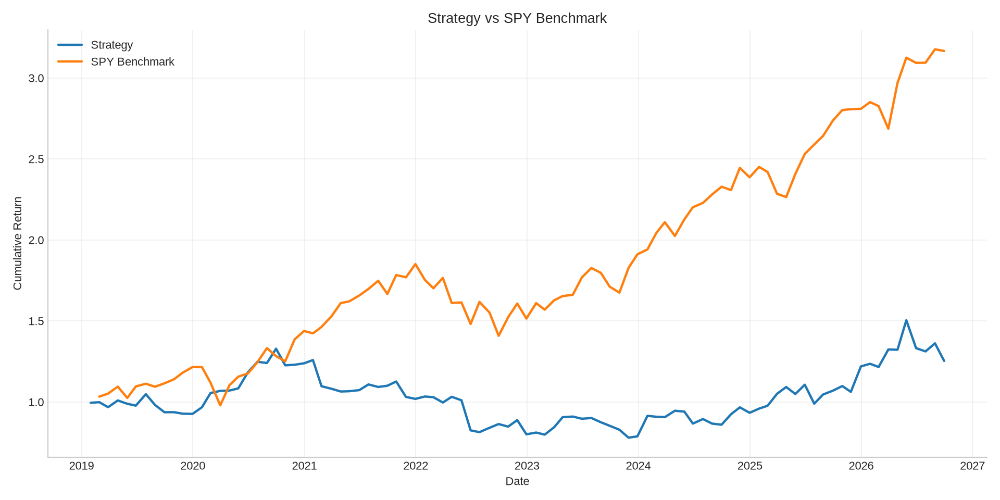

# Multi-Factor Machine Learning Trading Strategy

## Executive Summary

This project implements a modular quantitative equity research pipeline for a long/short strategy across S&P 100 equities. The research combines traditional cross-sectional factors, machine learning return ranking, walk-forward validation, transaction-cost-aware portfolio construction, and risk reporting.

Headline multi-factor metrics in this checkout are taken from committed
`results/multi_factor_results.csv` over **2019-01-31 → 2026-09-30** with PIT
eligibility, HTB borrow tiers, sector-neutral construction, **beta-neutral legs** (SPY, EWMA
betas) and **EWMA volatility targeting**: annual return **<!--m:mf.annual_return-->4.76%<!--/m-->**, annual volatility **<!--m:mf.annual_volatility-->19.27%<!--/m-->**,
Sharpe ratio **<!--m:mf.sharpe-->0.25<!--/m-->**, maximum drawdown **<!--m:mf.max_drawdown-->-41.35%<!--/m-->**, and cumulative return **<!--m:mf.cumulative-->25.29%<!--/m-->** (ending
wealth **<!--m:mf.ending_wealth-->1.2529<!--/m-->**). Walk-forward metrics in `results/walk_forward_metrics.csv`: annual return
**<!--m:wf.annual_return-->6.30%<!--/m-->**, Sharpe **<!--m:wf.sharpe-->0.45<!--/m-->**, max drawdown **<!--m:wf.max_drawdown-->-14.59%<!--/m-->**, cumulative **<!--m:wf.cumulative-->28.84%<!--/m-->** over <!--m:wf.n-->57<!--/m--> periods,
with beta-neutral legs and the pre-declared one-SE nested rule (`rf_default` every year).
Beta neutrality (design logged a priori) roughly halved both strategies' returns: much of the
earlier dollar-neutral performance was market exposure. Switching the beta estimator from
252-day OLS to EWMA (half-life 63 days, trial 43) changed little; the multi-factor book's
realized beta stays ≈ -0.2, which the diagnosis below attributes to a daily-vs-monthly horizon
mismatch rather than beta drift. Older narrative
snapshots (multi-factor Sharpe **1.16** / **0.39** / **0.23** / **0.26** / **0.30**, walk-forward
**0.88** / **0.70** / **0.63** / **0.37** / realized-vol **0.62** / EWMA with unscaled inner
scoring **0.62** / consistent-inner argmax **0.04** / dollar-neutral one-SE **0.71**; multi-factor
dollar-neutral EWMA **0.31**) are superseded.

The results are research outputs from a prototype workflow and should be interpreted with realistic caveats: the base ticker list is still a modern S&P 100-style snapshot (residual survivorship), eligibility uses an S&P 500 membership proxy rather than official S&P 100 PIT constituents, prices come from Yahoo Finance, transaction costs are simplified, and execution assumptions are idealized. They are not investment promises or live-trading claims.

## Research Objective

The objective is to evaluate whether simple equity factors and machine learning forecasts can support a cross-sectional long/short research strategy. The project is designed to demonstrate a disciplined research workflow:

- Build clean market data and factor datasets.
- Test standalone and combined research signals.
- Convert signals into a transparent equal-weight long/short portfolio.
- Evaluate out-of-sample machine learning predictions with walk-forward validation.
- Report performance, risk, drawdown, market exposure, and turnover.

The goal is not to claim production readiness or future returns. The goal is to show disciplined research structure, leakage-aware validation, and honest reporting of limitations.

## Data Pipeline

The project downloads historical adjusted equity prices using Yahoo Finance and stores derived datasets as local CSV files under `data/`. The research universe is described as S&P 100 equities over a 2018-2025 sample period.

The pipeline creates:

- Daily returns.
- 12-month momentum.
- 1-month mean reversion.
- 1-month forward returns.
- Machine learning feature/target datasets.

Forward returns are used only as labels or realized outcomes. They are not used when forming live portfolio scores, which is essential for leakage prevention.

## Alpha Factors

### 12-Month Momentum

Momentum measures whether stocks that have performed well over roughly the prior trading year continue to outperform. The project calculates:

```text
Momentum = Price(t) / Price(t - 252) - 1
```

This is a classic trend-following factor. Positive values indicate stronger trailing performance.

### Short-Term Momentum

Short-term momentum measures the recent 1-month return:

```text
ShortTermMomentum = Price(t) / Price(t - 21) - 1
```

This feature is used in the machine learning dataset as a recent continuation signal.

### Mean Reversion

The multi-factor strategy uses a 1-month mean-reversion input defined as the negative of the recent 1-month return. In the combined score, the strategy rewards stronger 12-month momentum and penalizes the mean-reversion component according to the existing implementation.

### Rolling Volatility

Rolling volatility is calculated as the 21-day standard deviation of daily returns. It is used as a machine learning feature to help the model distinguish between stable and unstable return environments.

## Portfolio Construction

The project uses equal-weight long/short portfolios. At each rebalance date, stocks are ranked cross-sectionally by a signal or model prediction.

For the multi-factor strategy:

- Rank stocks by the composite factor score.
- Go long the top 10 stocks.
- Go short the bottom 10 stocks.
- Rebalance monthly.
- Apply transaction costs of 10 bps per side.

Equal weighting makes the portfolio construction transparent and easy to audit. Research
long/short books now optionally **demean scores by sector** before ranking and **cap absolute
net sector exposure** (`research.sector_neutral`, `max_sector_net_exposure=0.15`) using the
static map in `data/sector_map.csv`. Min-ADV$ liquidity filtering and a 5% ADV participation
trade cap are wired into constraint diagnostics and paper/sim; multi-day capacity schedules and
PIT sector membership are still not fully modeled.

## Machine Learning Framework

The machine learning pipeline trains a Random Forest Regressor to predict 1-month forward returns using:

- 12-month momentum.
- Short-term momentum.
- 21-day rolling volatility.

The model is used to rank stocks, not to forecast exact prices. This distinction matters: in cross-sectional equity research, rank quality is often more important than point forecast accuracy.

The project also includes an XGBoost training entrypoint, but the reported machine learning strategy results in the README are based on the Random Forest walk-forward framework.

## Walk-Forward Validation

Walk-forward validation is used to reduce overfitting and make testing more realistic. The model is trained on historical data available before a test year and then evaluated on that unseen test year.

The reported walk-forward schedule is:

| Train Period | Test Period |
|---|---|
| 2018-2021 | 2022 |
| 2018-2022 | 2023 |
| 2018-2023 | 2024 |
| 2018-2024 | 2025 |
| 2018-2025 | 2026 (through 2026-09-30) |

This expanding-window process simulates how a research model would be retrained as new data becomes available.

Leakage prevention is handled by:

- Sorting observations chronologically.
- Training only on dates before the test period.
- Using forward returns only as labels and realized outcomes.
- Rebuilding predictions for unseen test periods before portfolio formation.

## Risk Management

The project includes a volatility-targeting overlay. Volatility targeting scales exposure based on recently observed portfolio volatility. If realized volatility is high, exposure is reduced; if volatility is low, exposure can increase subject to a leverage cap.

The implementation uses:

- Target volatility: **15%**.
- Lookback window: **6 months**.
- Maximum leverage: **2.0x**.
- A one-period lag on leverage so the current month is not sized using its own realized return.

This is a common risk control pattern, though it remains simplified because it does not model financing costs, margin constraints, borrow constraints, or intramonth risk changes.

## Research Realism & Limitations

### Nested Walk-Forward Selection

Outer year folds still use expanding training with purge/embargo. Inside each outer training
window, an anchored inner year loop scores a small candidate set (`ridge_1`, `rf_shallow`,
`rf_default`) on a month-end subset, then refits the winner on the full outer train sample
before predicting the outer test year.

Default inner score (`research.nested_inner_score=cost_aware_sharpe`):

`score = mean(net_t) / std(net_t) * sqrt(12)`, where each month-end
`net_t = sum_i s_t·w_{i,t}·r_{i,t} - ||Δ(s·w)||_1 * transaction_cost - financing(s_t·w_t)`,
where `w_t` comes from the same sector-demeaned, sector-net-capped constructor as the outer
book and `s_t = clip(target_vol / EWMA_forecast(net_{<t}), 0.5, 1.5)` uses only the candidate's
earlier inner-validation net returns (`research.nested_inner_vol_targeting`, default true;
false sets `s_t = 1`). Financing uses the configured rebate / cash-financing bps and, with
`research.nested_inner_name_level_borrow: true`, the same point-in-time HTB tier panel as the
outer book (row as-of each inner date) for short borrow.
Alternatives: `icir = mean(IC)/std(IC)`, `rank_ic = mean(IC)`.

**Selection rule (fixed a priori):** `research.nested_selection_rule=one_se_fallback`. Keep the
pre-declared default `rf_default` unless the inner-best candidate's paired per-month net-return
advantage exceeds `nested_selection_se_threshold=1.0` standard errors (one-SE rule). Rationale:
inner scores come from 12–60 months and are tightly clustered, so argmax mostly selects noise;
a fallback keeps one auditable production model. Alternatives behind config: `best` (argmax) and
`ensemble_equal` (equal-weight blend, members z-scored with training-set prediction stats).

Regenerated 2026-11-09: the inner argmax was `ridge_1` (2022–2025) / `rf_shallow` (2026), but its
paired advantage over `rf_default` had t ≈ 0.12–0.87 in every year, so **every year kept
`rf_default`**. The walk-forward result is therefore effectively the fixed production RF, and
`rf_default` itself reflects earlier research iteration on this history. This reduces test-year hyperparameter peeking
but does not eliminate candidate-menu or research-iteration bias.

### Survivorship Bias

The base equity list is still today's S&P 100-style snapshot, so names that left the index and
are not in `TICKERS` remain missing. Mitigation now in code (`src/data/universe.py`):

1. Tradability — require a valid price, a minimum history window (63 trading days), and treat
   trailing all-NaN stretches after the last print as delisted.
2. Index membership overlay — month-end S&P 500 membership for the same tickers
   (`data/universe_sp500_membership.csv`, derived from
   [chinobing/historical_sp500_constituents](https://github.com/chinobing/historical_sp500_constituents)).
   Because S&P 100 ⊆ S&P 500, non-members are excluded on that date (e.g. PLTR before Sep 2024,
   UBER before Dec 2023, TSLA before Dec 2020).

This reduces look-ahead membership bias for late joiners but does **not** restore historical
members that are absent from today's list. A production-grade study still needs official
point-in-time S&P 100 constituents (and delisted return series).

### Transaction Cost Simplifications

The strategy applies a flat 10 bps per side transaction cost. Real trading costs vary by liquidity, spread, volatility, market impact, short borrow fees, and order size. The current assumption is useful for research hygiene but is not a complete execution cost model.

### Borrow / Financing Costs

Research long/short portfolios use **name-level borrow tiers** when
`execution.borrow_tiering_enabled` is true. Each short name is mapped to GC /
elevated / HTB / special annualized bps via (1) optional overrides in
`data/borrow_tier_overrides.csv` and (2) an ADV$ + 63-day volatility proxy
(relative percentiles within the universe). Default rates: GC=100, elevated=300,
HTB=1000, special=3000 bps. Latest classification snapshot:
`data/borrow_tier_map.csv`. **This is a research proxy, not a live locate or
prime-broker HTB feed.** Paper/sim remains long-only, so short borrow is usually
zero there; the broker still supports per-name short accrual if shorts exist.

### Volatility Targeting
Research long/short books scale base gross exposure by
`target_volatility / forecast_volatility`. Default `research.vol_estimator=ewma`
uses an EWMA variance forecast with half-life `vol_ewma_half_life=3` month-end
periods (`lambda = 0.5^(1/half_life)`); `vol_estimator=realized` keeps the trailing
sample stdev over `vol_lookback_periods=6`. Target 15%, scale clipped to [0.5, 1.5].
Only returns *before* the rebalance date enter the estimate (no look-ahead).
Paper/sim defaults to EWMA with half-life 21 daily NAV returns and
`vol_max_scale=1.0` (no leverage). Nested inner `cost_aware_sharpe` applies the same causal
vol scale (from inner-validation history only) and sector-capped weights as the outer book.

### Sector Neutrality
Research L/S construction demeans cross-sectional scores within each sector and then caps
`|net|` sector exposure (default 0.15 of NAV), restoring overall gross only when the caps
allow. The sector map is static (`data/sector_map.csv` / `SECTOR_MAP`) — **not** historical
point-in-time GICS. Residual industry risk remains when a sector has few eligible names or when
gross must be reduced to satisfy the net cap.

### Yahoo Finance Limitations

Yahoo Finance is convenient for research prototypes, but it is not institutional market data. Potential issues include missing data, adjusted-price methodology differences, symbol mapping changes, restatements, and survivorship concerns.

### Execution Assumptions

Research PnL paths still assume month-end fills at the rebalance price with equal weights.
Constraint diagnostics and paper/sim now apply a **5% ADV participation** trade cap
(`risk_limits.max_adv_participation`) on top of the min-ADV$ liquidity filter; leftover weight
stays in cash. They still do not model multi-day participation schedules, borrow availability /
locate failures, intraday execution, corporate action edge cases, or tax effects. Research
borrow/financing and paper/sim slippage + half-spread + sqrt impact remain separate cost layers.

### Model and Validation Constraints

The machine learning model uses a small feature set and a simple target. Walk-forward validation is more realistic than a static split, but it does not fully address regime changes, feature decay, hyperparameter selection bias, or repeated research iteration.

## Performance Metrics

Source of truth for the multi-factor backtest in this repository checkout:
`results/multi_factor_results.csv` (`portfolio_return`), sample
**2019-01-31 → 2026-09-30** (93 month-end rows). Ending wealth in
`results/multi_factor_equity_curve.csv` is **<!--m:mf.ending_wealth-->1.2529<!--/m-->** (beta-neutral legs with EWMA betas; OLS betas 1.2729; dollar-neutral 1.3882).

| Metric | Value from committed multi-factor results | OLS betas (fe8b173) |
|---|---:|---:|
| Annual Return | <!--m:mf.annual_return-->4.76%<!--/m--> | 4.98% |
| Annual Volatility | <!--m:mf.annual_volatility-->19.27%<!--/m--> | 19.33% |
| Sharpe Ratio | <!--m:mf.sharpe-->0.25<!--/m--> | 0.26 |
| Max Drawdown | <!--m:mf.max_drawdown-->-41.35%<!--/m--> | -41.04% |
| Cumulative Return | <!--m:mf.cumulative-->25.29%<!--/m--> | 27.29% |
| Average One-Way Turnover (rebalance log, after first) | <!--m:mf.turnover_avg-->123.91%<!--/m--> | 124.09% |
| Mean vol scale | <!--m:mf.vol_scale-->0.89<!--/m--> | 0.89 |

`make report` regenerates the same family of numbers into local
`results/reports/summary_report.md` / `.csv` (gitignored).

### Walk-forward ML (regenerated 2026-11-09, beta-neutral legs with EWMA betas + one-SE nested selection)

From `results/walk_forward_metrics.csv`, with month-end rebalancing, purge/embargo, research
L/S base gross 2.0, PIT eligibility, HTB tiers, sector neutrality, **beta-neutral legs** (SPY,
EWMA betas, half-life 63 days, within the trailing 252 days, Blume-shrunk; same panel in the
nested inner scorer), **EWMA vol
targeting**, and nested `cost_aware_sharpe` under `one_se_fallback`. Nested choices:
2022–2026=`rf_default` (fallback 2022/2023/2025; default was inner-best 2024/2026). Mean
research vol scale ≈ <!--m:wf.vol_scale-->1.14<!--/m-->. Sample: **2022-01-31 → 2026-09-30** (<!--m:wf.n-->57<!--/m--> periods).

| Metric | β-neutral, EWMA betas | β-neutral, OLS betas (fe8b173) | Dollar-neutral (147723c) |
|---|---:|---:|---:|
| Annual return | <!--m:wf.annual_return-->6.30%<!--/m--> | 5.97% | 11.62% |
| Annual volatility | <!--m:wf.annual_volatility-->14.05%<!--/m--> | 13.98% | 16.29% |
| Sharpe ratio | <!--m:wf.sharpe-->0.45<!--/m--> | 0.43 | 0.71 |
| Max drawdown | <!--m:wf.max_drawdown-->-14.59%<!--/m--> | -15.94% | -20.08% |
| Cumulative return | <!--m:wf.cumulative-->28.84%<!--/m--> | 26.84% | 62.96% |
| Realized β vs SPY | <!--m:rel.wf.spy.beta-->0.11<!--/m--> | 0.14 | 0.54 |

### Beta-Neutral Construction

Design fixed a priori and logged (trial log rows 41–42) before running: per-name OLS beta vs
SPY over the trailing 252 trading days ending at the rebalance date (≥126 obs, else 1),
Blume-shrunk `2/3·β + 1/3`; long and short legs rescaled at fixed gross so long-leg beta equals
short-leg beta, gross ratio bounded to [0.5, 2]; alternated with sector net caps (≤5 rounds);
vol targeting scales the whole book afterwards. SPY was chosen over the equal-weight universe
because it is investable and independent of the survivorship-biased ticker list. Ex-ante beta is
≈ 0 at every walk-forward rebalance and 92/93 multi-factor rebalances. Realized beta falls to
0.14 for walk-forward but stays ≈ -0.2 for multi-factor, whose market exposure is time-varying.
Both strategies' returns fell; we keep the design as default rather than revert on outer-test
results.

**Why is the multi-factor realized beta negative while ex-ante beta ≈ 0? (diagnosis, run on the
fe8b173 OLS construction; `python research/diagnose_multi_factor_beta.py` →
`results/multi_factor_beta_diagnosis.csv`).** The EWMA design (below) was fixed before this
diagnosis ran, and nothing here was tuned on outer-test results. Averages over 93 rebalances:

| Quantity | Long leg | Short leg | Book |
|---|---:|---:|---:|
| Ex-ante beta (252-day OLS, shrunk, at rebalance) | 1.12 | 1.02 | 0.00 |
| Ex-post daily beta of the same names over the *next* 252 days (look-ahead, diagnostic only) | 1.15 | 0.98 | +0.07 |
| Realized beta of the leg's *monthly* return on SPY's monthly return | 0.97 | 1.13 | -0.15 (unscaled), -0.20 (reported) |
| Mean 63-day volatility (universe 0.30) | 0.35 | 0.33 | — |

- **Beta drift is not the explanation.** Measured on daily returns, the held names' betas barely
  move: even with look-ahead the book nets to +0.07, the *opposite* sign of the realized -0.2.
- **Horizon mismatch is.** At the monthly horizon the long leg (strong 12-month momentum,
  recent losers) moves less than its daily beta implies and the short leg (weak momentum,
  recent winners) moves more. Daily and monthly betas differ when returns are autocorrelated
  at short lags (reversal / partial-adjustment effects, typical of the 1-month reversal
  component); the book is balanced on daily betas but held for a month.
- **Nonlinearity contributes.** Within up months the unscaled book's beta is +0.12 and within
  down months ≈ 0.00, yet the pooled slope is -0.15: the book does relatively better in down
  months and worse in up months (momentum-crash-like payoff), which a linear beta of either
  frequency cannot hedge.
- **Not a low-volatility tilt:** both legs are *more* volatile than the universe (0.35 / 0.33 vs
  0.30), and gross is close to balanced (long 0.96 / short 1.04).
- **Vol scaling amplifies slightly:** -0.15 unscaled → -0.20 reported; the vol scale is mildly
  negatively correlated with next-month SPY (-0.10).

Implication (the diagnosis was run before trial 43's backtests): an EWMA (faster) daily-beta estimator
addresses drift, which the diagnosis says is small, so it was **not expected** to remove the
negative realized beta. A monthly-horizon beta or an explicit nonlinear/factor hedge would
address the actual cause, but each would be another trial; we did not run one.

**EWMA beta estimator (trial 43, design fixed a priori).** Per-name beta is the weighted least
squares slope on SPY with weights `0.5^(k/63)` (k = trading days before the rebalance close)
inside the same 252-day window, same ≥126-observation rule, same Blume shrinkage and β = 1
fallback; `research.beta_estimator: ols` reproduces fe8b173 exactly (max panel difference
4e-15). Half-life 63 days = one quarter: the usual horizon for drift in factor-portfolio
composition, ≈ 180 effective observations so estimates are not noise-dominated; not tuned.
Applied identically to multi-factor, walk-forward outer book and nested inner scorer, and kept
as the default regardless of outcome. Mean absolute change in per-name betas vs OLS ≈ 0.05.
Result: multi-factor Sharpe 0.26 → <!--m:mf.sharpe-->0.25<!--/m-->, realized β vs SPY -0.20 → <!--m:rel.mf.spy.beta-->-0.19<!--/m--> (EW <!--m:rel.mf.ew.beta-->-0.30<!--/m--> → -0.30),
HAC α t 1.39 → <!--m:rel.mf.spy.alpha_t-->1.35<!--/m--> (EW 1.79 → <!--m:rel.mf.ew.alpha_t-->1.76<!--/m-->), ex-ante β ≈ 0 on <!--m:mf.ex_ante_neutral_count-->91<!--/m-->/<!--m:mf.n-->93<!--/m--> rebalances (the 2:1 leg-ratio
bound binds twice); walk-forward Sharpe 0.43 → <!--m:wf.sharpe-->0.45<!--/m-->, realized β 0.14 → <!--m:rel.wf.spy.beta-->0.11<!--/m-->, α t 0.65 → <!--m:rel.wf.spy.alpha_t-->0.76<!--/m-->.
All changes are within noise; the residual multi-factor beta remains, as the diagnosis predicted.

Superseded: dollar-neutral one-SE (147723c) 11.62% / 16.29% vol / Sharpe 0.71 / -20.08% /
+62.96%; consistent-inner argmax (2c6d681) 0.63% / 17.73% vol / Sharpe 0.04 / -22.46% /
-4.18%; unscaled inner scoring 10.17% / Sharpe 0.62 / -15.41% / +52.11%. Sensitivity only (not
used to pick the default): `best` 0.63% / Sharpe 0.04 (same with flat inner borrow);
`ensemble_equal` 12.45% / 17.69% vol / Sharpe 0.70 / -17.20% / +67.75%. The gain versus argmax
comes from not switching on noise, not from new signal; a 57-month Sharpe of ~0.7 has a wide
confidence interval (≈ ±0.9 at 95%).

### Statistical Significance (regenerated 2026-11-09)

From `results/significance_report.csv` and `results/benchmark_relative_report.csv`
(`src/run_significance_report.py`): stationary block bootstrap (5,000 resamples, seed 42, mean
block 4 months / 13 days), Probabilistic Sharpe Ratio vs 0, and Deflated Sharpe Ratio with
**N = <!--m:trials.n-->57<!--/m--> trials** read from `research/trial_log.csv` (<!--m:trials.logged-->43<!--/m--> logged variants + <!--m:trials.padding-->14<!--/m--> documented
padding) and cross-trial Sharpe variance from each family's logged Sharpes.

| Series | T | Sharpe | 95% CI | PSR(0) | SR0 | DSR (N=<!--m:trials.n-->57<!--/m-->) | DSR (N=200) |
|---|---:|---:|---|---:|---:|---:|---:|
| Walk-forward ML (β-neutral) | <!--m:sig.wf.n_obs-->57<!--/m--> m | <!--m:sig.wf.sharpe-->0.45<!--/m--> | <!--m:sig.wf.ci-->[-0.41, 1.27]<!--/m--> | <!--m:sig.wf.psr-->0.84<!--/m--> | <!--m:sig.wf.sr0-->0.59<!--/m--> | <!--m:sig.wf.dsr-->0.37<!--/m--> | <!--m:sig.wf.dsr_n200-->0.29<!--/m--> |
| Multi-factor L/S (β-neutral) | <!--m:sig.mf.n_obs-->93<!--/m--> m | <!--m:sig.mf.sharpe-->0.25<!--/m--> | <!--m:sig.mf.ci-->[-0.38, 0.89]<!--/m--> | <!--m:sig.mf.psr-->0.75<!--/m--> | <!--m:sig.mf.sr0-->0.65<!--/m--> | <!--m:sig.mf.dsr-->0.13<!--/m--> | <!--m:sig.mf.dsr_n200-->0.07<!--/m--> |
| Multi-day sim (long-only) | <!--m:sig.sim.n_obs-->1968<!--/m--> d | <!--m:sig.sim.sharpe-->0.88<!--/m--> | <!--m:sig.sim.ci-->[0.32, 1.50]<!--/m--> | <!--m:sig.sim.psr-->0.99<!--/m--> | <!--m:sig.sim.sr0-->0.11<!--/m--> | <!--m:sig.sim.dsr-->0.98<!--/m--> (<!--m:sig.sim.dsr_pooled-->0.72<!--/m--> pooled V) | <!--m:sig.sim.dsr_n200-->0.98<!--/m--> (<!--m:sig.sim.dsr_pooled_n200-->0.60<!--/m--> pooled V) |
| Daily-rebalanced equal-weight universe (reference) | <!--m:sig.ref.n_obs-->1968<!--/m--> d | <!--m:sig.ref.sharpe-->1.08<!--/m--> | <!--m:sig.ref.ci-->[0.41, 1.86]<!--/m--> | <!--m:sig.ref.psr-->1.00<!--/m--> | — | — | — |

Benchmark-relative (OLS with Newey–West HAC SEs; IR and causal beta-hedged Sharpe deflated with
N = <!--m:trials.n-->57<!--/m--> and pooled V[SR]):

| Series | Benchmark | α (ann.) | α t | β | IR [95% CI] | Causal hedged SR | Hedged DSR |
|---|---|---:|---:|---:|---|---:|---:|
| Walk-forward ML (β-neutral) | EW universe | <!--m:rel.wf.ew.alpha-->5.7%<!--/m--> | <!--m:rel.wf.ew.alpha_t-->0.91<!--/m--> | <!--m:rel.wf.ew.beta-->0.04<!--/m--> | <!--m:rel.wf.ew.ir-->-0.49<!--/m--> <!--m:rel.wf.ew.ir_ci-->[-1.21, 0.17]<!--/m--> | <!--m:rel.wf.ew.hedged_causal-->0.44<!--/m--> | <!--m:rel.wf.ew.hedged_causal_dsr-->0.34<!--/m--> |
| Walk-forward ML (β-neutral) | SPY | <!--m:rel.wf.spy.alpha-->4.8%<!--/m--> | <!--m:rel.wf.spy.alpha_t-->0.76<!--/m--> | <!--m:rel.wf.spy.beta-->0.11<!--/m--> | <!--m:rel.wf.spy.ir-->-0.37<!--/m--> <!--m:rel.wf.spy.ir_ci-->[-1.11, 0.32]<!--/m--> | <!--m:rel.wf.spy.hedged_causal-->0.40<!--/m--> | <!--m:rel.wf.spy.hedged_causal_dsr-->0.32<!--/m--> |
| Multi-factor L/S (β-neutral) | EW universe | <!--m:rel.mf.ew.alpha-->10.5%<!--/m--> | <!--m:rel.mf.ew.alpha_t-->1.76<!--/m--> | <!--m:rel.mf.ew.beta-->-0.30<!--/m--> | <!--m:rel.mf.ew.ir-->-0.52<!--/m--> <!--m:rel.mf.ew.ir_ci-->[-1.03, 0.00]<!--/m--> | <!--m:rel.mf.ew.hedged_causal-->0.43<!--/m--> | <!--m:rel.mf.ew.hedged_causal_dsr-->0.28<!--/m--> |
| Multi-factor L/S (β-neutral) | SPY | <!--m:rel.mf.spy.alpha-->7.9%<!--/m--> | <!--m:rel.mf.spy.alpha_t-->1.35<!--/m--> | <!--m:rel.mf.spy.beta-->-0.19<!--/m--> | <!--m:rel.mf.spy.ir-->-0.42<!--/m--> <!--m:rel.mf.spy.ir_ci-->[-0.95, 0.11]<!--/m--> | <!--m:rel.mf.spy.hedged_causal-->0.32<!--/m--> | <!--m:rel.mf.spy.hedged_causal_dsr-->0.20<!--/m--> |
| Multi-day sim | EW universe | <!--m:rel.sim.ew.alpha-->2.3%<!--/m--> | <!--m:rel.sim.ew.alpha_t-->0.49<!--/m--> | <!--m:rel.sim.ew.beta-->0.81<!--/m--> | <!--m:rel.sim.ew.ir-->-0.10<!--/m--> <!--m:rel.sim.ew.ir_ci-->[-0.73, 0.52]<!--/m--> | <!--m:rel.sim.ew.hedged_causal-->0.20<!--/m--> | <!--m:rel.sim.ew.hedged_causal_dsr-->0.10<!--/m--> |
| Multi-day sim | SPY | <!--m:rel.sim.spy.alpha-->4.2%<!--/m--> | <!--m:rel.sim.spy.alpha_t-->0.91<!--/m--> | <!--m:rel.sim.spy.beta-->0.85<!--/m--> | <!--m:rel.sim.spy.ir-->0.11<!--/m--> <!--m:rel.sim.spy.ir_ci-->[-0.54, 0.72]<!--/m--> | <!--m:rel.sim.spy.hedged_causal-->0.37<!--/m--> | <!--m:rel.sim.spy.hedged_causal_dsr-->0.21<!--/m--> |

No series shows statistically significant alpha: all HAC t-stats are below 1.96 before any
multiple-testing adjustment and all deflated statistics are far below 0.95. Beta-neutral legs
cut the walk-forward book's realized β from 0.54 to <!--m:rel.wf.spy.beta-->0.11<!--/m-->–0.14 (its Sharpe fell from 0.71 to 0.43–0.45);
the multi-factor book keeps a realized β ≈ -0.2 and remains insignificant after deflation; the
long-only simulation's Sharpe is equity beta (IR vs SPY ≈ 0.1). IR versus a long-only benchmark
is not a meaningful skill test for the L/S books — use alpha and hedged Sharpe there.

### Older narrative snapshot (not current)

Earlier versions of this report quoted annual return **24.92%**, volatility **21.43%**,
Sharpe **1.16**, max drawdown **-20.43%**, cumulative return **196.10%**, turnover
**137.41%**, latest turnover **110.00%**, beta **-0.42**, plus walk-forward ML
**23.1%** annual return / Sharpe **0.88**. Those figures are retained here only as
historical narrative; they are not reproduced by the regenerated artifacts. Corrected walk-forward metrics are in
`results/walk_forward_metrics.csv`.

Sharpe ratio measures annualized return per unit of annualized volatility. A higher Sharpe indicates more return for each unit of risk, but it does not capture tail risk, liquidity risk, or path dependence.

Drawdown measures the percentage decline from a prior equity high. Maximum drawdown is important because investors experience losses through the path of returns, not just through average return and volatility.



Risk charts under `results/reports/` are produced locally by `make report` and are not always present on GitHub.

## Risk Analytics

### Drawdown

The drawdown chart shows how far the strategy falls below its previous peak through time. This helps identify periods of stress and recovery.

_Drawdown chart: run `make report` to generate `results/reports/drawdown.png` locally._

### Rolling Sharpe

Rolling Sharpe evaluates whether return efficiency is stable over time. A strategy with a strong full-sample Sharpe can still be unattractive if performance is concentrated in a short subperiod.

_Rolling Sharpe chart: run `make report` to generate `results/reports/rolling_sharpe.png` locally._

### Rolling Volatility

Rolling volatility measures how unstable portfolio returns are over a recent window. Rising volatility can indicate a changing market regime or increased strategy risk.

_Rolling volatility chart: run `make report` to generate `results/reports/rolling_volatility.png` locally._

### Beta

Beta measures sensitivity to SPY. A beta of 1.0 means the strategy tends to move like SPY, while a beta near 0.0 indicates low linear market exposure. The full-sample HAC regression of the committed multi-factor returns on SPY gives β ≈ **<!--m:rel.mf.spy.beta-->-0.19<!--/m-->** (<!--m:rel.mf.ew.beta-->-0.30<!--/m--> vs the equal-weight universe) despite ex-ante beta ≈ 0; see the diagnosis under "Beta-Neutral Construction". (An earlier version of this paragraph quoted a stale rolling beta of 0.72 and called it negative; that was inconsistent and has been removed.)

### Turnover

Turnover measures how much the portfolio changes between rebalances. Average one-way turnover of about **<!--m:mf.turnover_avg-->123.91%<!--/m-->** (latest **<!--m:mf.turnover_latest-->84.05%<!--/m-->**, from `results/multi_factor_results.csv`) indicates meaningful monthly portfolio churn. High turnover can erode live performance once spreads, slippage, borrow fees, and market impact are modeled more completely.

## Key Findings

- From regenerated `results/multi_factor_results.csv` (beta-neutral legs, EWMA betas), the multi-factor series shows **<!--m:mf.annual_return-->4.76%<!--/m--> annual return**, **<!--m:mf.sharpe-->0.25<!--/m--> Sharpe**, **<!--m:mf.max_drawdown-->-41.35%<!--/m--> max drawdown**, and **<!--m:mf.cumulative-->25.29%<!--/m--> cumulative return** over 2019-01-31 → 2026-09-30 (<!--m:mf.n-->93<!--/m--> periods); OLS betas gave 4.98% / 0.26, dollar-neutral 6.43% / 0.31. Its realized β ≈ <!--m:rel.mf.spy.beta-->-0.19<!--/m--> vs SPY persists (daily-vs-monthly beta horizon mismatch, not drift).
- Walk-forward ML with beta-neutral legs and the one-SE nested rule shows **<!--m:wf.annual_return-->6.30%<!--/m--> annual return**, **<!--m:wf.sharpe-->0.45<!--/m--> Sharpe**, **<!--m:wf.max_drawdown-->-14.59%<!--/m--> max drawdown**, **<!--m:wf.cumulative-->28.84%<!--/m--> cumulative** over 2022-01-31 → 2026-09-30 (<!--m:wf.n-->57<!--/m--> periods), realized SPY β <!--m:rel.wf.spy.beta-->0.11<!--/m--> (OLS betas: 5.97% / 0.43 / β 0.14); the dollar-neutral version (11.62% / 0.71, β 0.54) owed much of its return to market exposure. Earlier argmax (0.63% / 0.04), unscaled-inner EWMA (10.17% / 0.62) and older figures are superseded.
- Significance: beta-neutral walk-forward ML Sharpe <!--m:sig.wf.sharpe-->0.45<!--/m--> has a 95% block-bootstrap CI of <!--m:sig.wf.ci-->[-0.41, 1.27]<!--/m--> and Deflated Sharpe Ratio **<!--m:sig.wf.dsr-->0.37<!--/m-->** at N = <!--m:trials.n-->57<!--/m--> logged-plus-padded trials; multi-factor DSR is **<!--m:sig.mf.dsr-->0.13<!--/m-->**. No series has significant alpha vs SPY or the equal-weight universe (all HAC t < 1.96); the long-only sim's Sharpe is market beta.
- The architecture now separates data, features, models, portfolio construction, backtests, risk, and reporting into reusable modules.
- Risk analytics add review context by reporting drawdown, rolling Sharpe, rolling volatility, beta, turnover, and cumulative return.
- The research remains a prototype until official S&P 100 PIT constituents (not only an S&P 500 proxy), more realistic trading costs, borrow assumptions, and production-grade data are added.

## Future Improvements

- Extend eligibility to official S&P 100 point-in-time constituents and include delisted/removed names in the price panel.
- Add a realistic transaction cost model based on spreads, ADV, volatility, market impact, and short borrow costs.
- Replace the static sector map with point-in-time GICS and add beta / style-factor exposure reporting.
- Add position-level and rebalance-level audit trails.
- Add benchmark-relative attribution and factor contribution analysis.
- Extend capacity analysis beyond the 5% ADV participation trade cap (e.g. multi-day
  participation schedules, venue-level liquidity, and AUM stress at institutional size).
- Add robust experiment tracking for model versions, features, parameters, and validation windows.
- The multi-factor book's residual negative realized beta is diagnosed (daily-vs-monthly beta horizon mismatch plus a nonlinear, momentum-crash-like payoff); EWMA betas (trial 43) did not remove it, as predicted. A monthly-horizon beta or factor hedge would be a further trial and is deliberately deferred to avoid inflating the trial count; priority now goes to engineering (data freshness, robustness, paper-trading ops). Widen the nested candidate menu only with purge/embargo and the one-SE rule.
- Add production-quality data checks for stale prices, corporate actions, missing data, and symbol changes.
